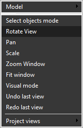

# インタラクティブ回転

[<strong>右クリック</strong>]のまま、メインの表示画面上でドラッグして回転させます。あるいは、グラフィックウィンドウのポップアップメニューから <strong>"ビュー回転"</strong> 項目を使用して、ビュー回転モードを有効にします。

上下にドラッグすると横軸を中心に回転し、左右にドラッグすると縦軸を中心に回転します。

<strong>[X]、[Y]、または[Z]</strong> キーを押したままマウスをドラッグすると、有効な座標系のX軸、Y軸、またはZ軸を中心に回転します。

回転中に <strong>[Space]</strong> を押し続けると、回転がループし、連続的にアニメーション表示されます。 <strong>[Esc]</strong> キーを押して連続回転モードを終了します。

ビュー方向の変更は、[標準ビュー](728.md)ボタンから行うことも可能です。

グラフィックウィンドウで[<strong>マウス中央ボタン</strong>] (マウスホイール)をクリックすると、現在のビューベクトルを最も近い標準ビューに完全に回転します。

このソフトウェアは、SpaceNavigatorのような様々な3Dマウスデバイスもサポートしています。
