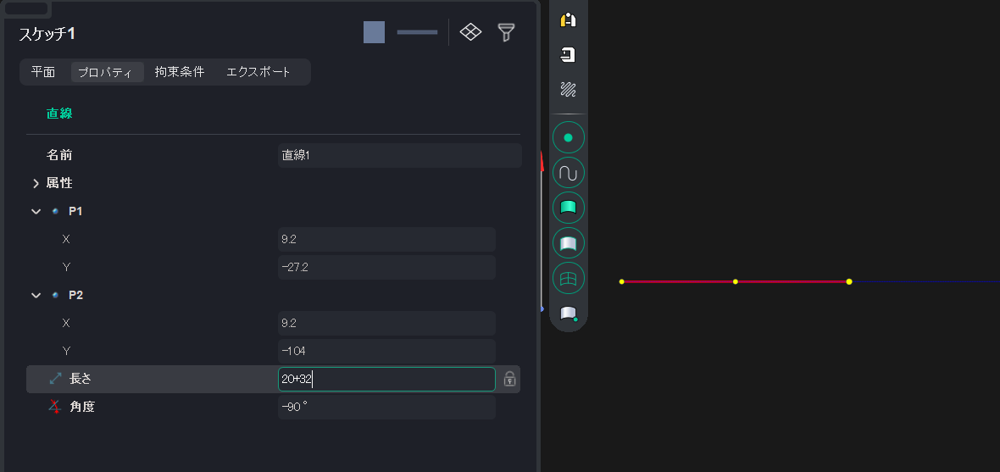
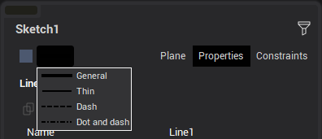
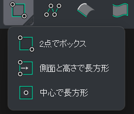

# Costruzione e modifica degli elementi

Quasi tutti gli elementi vengono costruiti secondo uno scenario tipico: si indica il primo punto nodale dell'oggetto, poi i successivi. Quando viene costruito l'ultimo punto, la costruzione dell'oggetto termina e inizia la costruzione dell'oggetto successivo dello stesso tipo. Per rimanere nella modalità di modifica dell'elemento, è necessario premere il tasto <strong>[Maiusc]</strong> e solo dopo specificare l'ultimo punto.

Un metodo alternativo di costruzione consiste nell'inserire le coordinate dei punti o i parametri nel <strong>Property inspector</strong> (ispettore delle proprietà). L'inserimento di valori numerici supporta la modalità di calcolo. Ciò significa che è possibile inserire un valore sotto forma di semplice formula:

Premendo il tasto <strong>[Esc]</strong> in qualsiasi momento si annulla la costruzione dell'elemento. Lo stesso risultato si ottiene premendo nuovamente il pulsante di costruzione dell'elemento.

Durante la costruzione e la modifica di un elemento è possibile impostarne il colore e il tipo di linea. Questi parametri sono controllati dai pulsanti situati sopra l'ispettore.

Inoltre, il tipo di linea può essere modificato con le scorciatoie da tastiera <strong>[Alt+1]</strong>, <strong>[Alt+2]</strong>, <strong>[Alt+3]</strong>, <strong>[Alt+4]</strong>.

Alcuni oggetti possono essere costruiti in modi diversi. Per selezionare un metodo alternativo, fare clic sul triangolo nell'angolo inferiore destro del pulsante, oppure fare clic con il tasto destro del mouse e selezionare la voce desiderata nel menu a discesa.

Fanno eccezione elementi come smussi, raccordi, quote e tratteggi, che saranno indicati nella descrizione di tali elementi.
