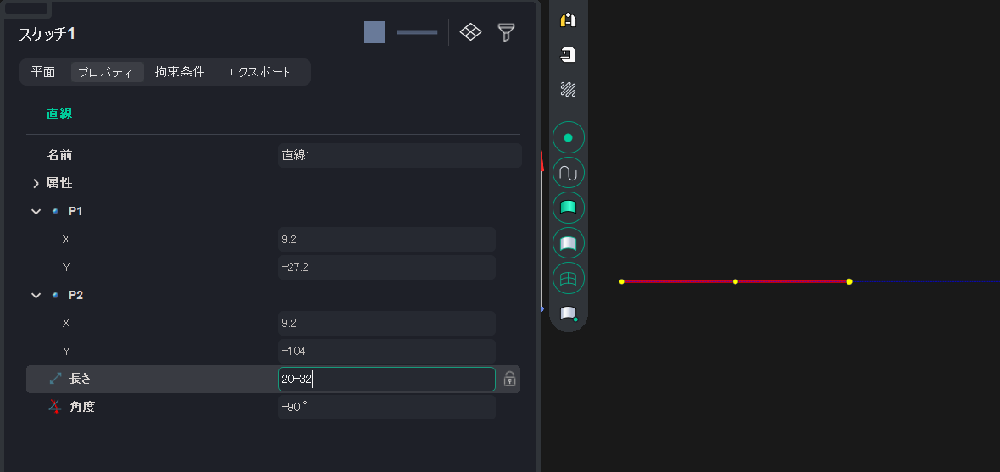
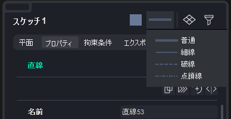

# Building and editing elements

Almost all elements are built according to a typical scenario: the first nod point of the object is indicated, then the next ones and subsequent ones. When the last point is built, the construction of the object ends and the construction of the next object of the same type begins. In order to stay in the element editing mode, you must press the **[Shift]** key and only then specify the last point.

An alternative way of building is to enter point coordinates or parameters in the **Property inspector**. Entering numerical values supports the calculation mode. It means, that you can enter a value in the form of a simple formula:

Pressing the **[Esc]** key at any time will cancel the element building. The same result is obtained by pressing the element building button again.

When building and editing an element, you can set its color and line type. These parameters are controlled by the buttons located above the inspector.

Also, the line type can be changed with a keyboard shortcuts **[Alt+1]**, **[Alt+2]**, **[Alt+3]**, **[Alt+4]**.

Some objects allow you to build them in different ways. To select an alternative method, you need to click on the triangle in the lower right corner of the button, or right-click and select the desired item in the drop-down menu.

Chamfers, roundings, dimensions and [hatching](20050.md) use their own construction workflows, described on their respective pages.

## Numeric fields and appearance

**Formulas.** Numeric fields accept `+ - * / ^`, parentheses and `LOG` (base 10), `LN`, `EXP`, `SQRT`, `ABS`, `MIN(a,b)`, `MAX(a,b)`, `SGN`, `SIN`, `COS`, `TG`, `CTG`. Angles are in degrees. Division by zero and square roots of negative numbers are errors; the value is not accepted. The mouse wheel changes the value by 1, by 0.1 with **[Shift]**, or by 10 with **[Ctrl]**, replacing the formula with a number.

**Automatic locking.** A keyboard value confirmed with **[Enter]** locks the field. The mouse wheel does not lock it.

**Line type.** Top-row digit shortcuts select **General** (**[Alt+1]**), **Thin** (**[Alt+2]**), **Dash** (**[Alt+3]**) or **Dot and dash** (**[Alt+4]**).

**Color.** The color and line type buttons above the inspector show the selected object's values, or the values for new objects when nothing is selected. **Default color** removes a manual color. **Apply default colors to drawing** restores default colors for the entire sketch as one undo step. Defaults differ for general geometry, thin and dashed lines, dimensions and symbols, and hatches, and for light and dark themes. A manual color remains active for new objects until **Default color** is selected.

**Construction mode.** **[Esc]** or clicking the command button again exits the mode. **[Del]** discards the unfinished object but keeps the command active. **[Shift]** while placing the last point keeps the object in editing.

## Grid, undo and redo

**Grid.** The button or **[Ctrl+G]** toggles the grid, which is off by default. Spacing adjusts to the view scale. Points can snap to grid nodes during entry.

**Undo**, **Redo**. **[Ctrl+Z]** undoes one action; **[Ctrl+Shift+Z]** redoes it. Each plane has its own history, which is not saved in the file. Plane changes are excluded from this history.
