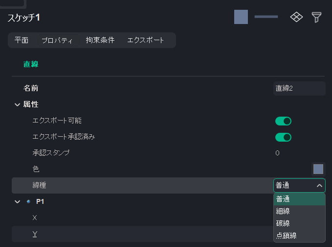
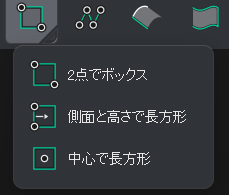

# 要素の作成と編集

ほとんどの要素は典型的な手順に従って作成されます。最初にオブジェクトの第一ノードを指定し、その後に次のノードおよびそれ以降のノードを順に指定します。最後の点を作成すると、そのオブジェクトの作成が終了し、同じ種類の次のオブジェクトの作成が開始されます。要素編集モードを継続するには、 <strong>[Shift]</strong> キーを押したまま最後の点を指定する必要があります。

別の作成方法として、 <strong>`プロパティインストラクター`</strong>に点の座標やパラメータを入力する方法があります。数値の入力は計算モードが対応して動作するため、値を簡単な数式の形式で入力することができます。

<strong>[Esc]</strong>キーを押すと、いつでも要素の作成をキャンセルできます。

要素作成ボタンを再度押しても、同じ結果が得られます。要素の作成および編集時には、その色や線種を設定できます。これらのパラメーターは、インスペクターの上にあるボタンで操作します。

 また、 <strong>[Alt+1]</strong>, <strong>[Alt+2]</strong>, <strong>[Alt+3]</strong>, <strong>[Alt+4]</strong>で線の種類を変更できます。

オブジェクトによっては、さまざまな方法で組み立てることができます。代替方法を選択するには、ボタン右下の三角をクリックするか、右クリックしてドロップダウンメニューから目的の項目を選択します。

例外として扱われる要素には、面取り、フィレット、寸法、ハッチングなどがあります。
