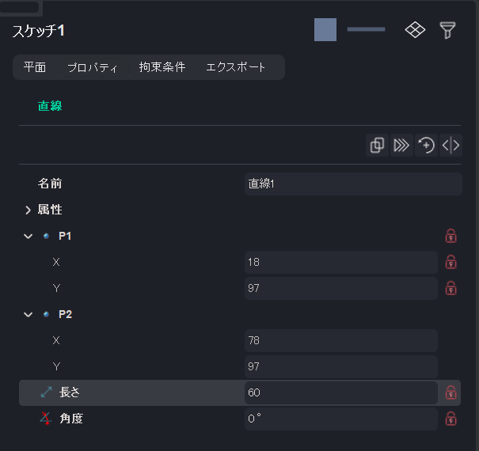
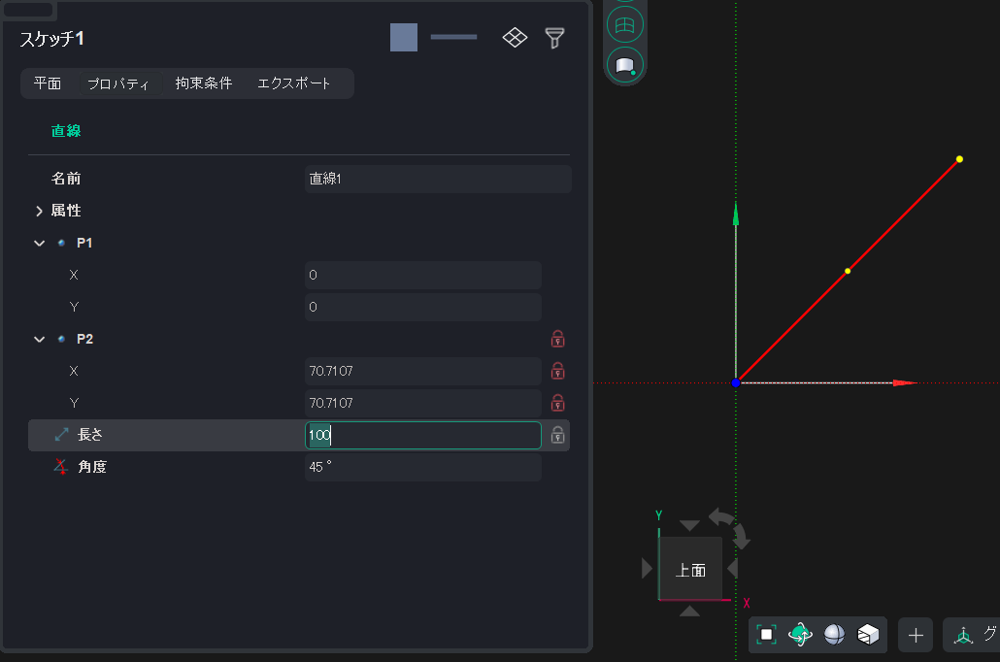
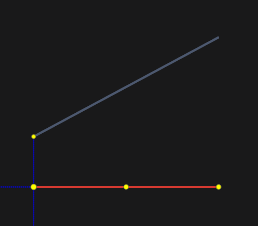
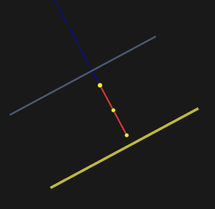
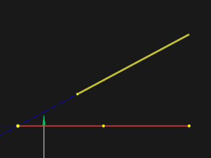
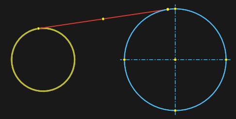

# Linea

La <strong>Line</strong> (linea) è costruita su due punti e ha un punto, posto sulla linea, che la divide a metà. La linea viene costruita specificando le coordinate dei suoi estremi nel <strong>Property inspector</strong> (ispettore delle proprietà). Inoltre, con il mouse è possibile spostare la linea afferrandola per il punto medio, senza modificarne la lunghezza e l'angolo di rotazione. Quando il cursore afferra gli estremi della linea, è possibile modificarne dinamicamente la lunghezza e l'angolo di rotazione. Se si tiene premuto il tasto <strong>[Maiusc]</strong>, la linea viene spostata senza modificarne la lunghezza e l'angolo. Un doppio clic su una circonferenza o su un arco crea le linee d'asse di tale arco o circonferenza.

Parametri della linea nella finestra <strong>Property inspector</strong>:

Durante la modifica di una linea, tutti questi parametri possono essere bloccati facendo clic sul simbolo del "lucchetto" nell'inspector oppure sull'icona corrispondente sulla linea stessa.

Durante la costruzione e la modifica di una linea è possibile avvalersi di linee guida. Per impostazione predefinita, le guide vengono proposte a 0°, 45°, 90° e all'angolo con cui il segmento è stato creato in precedenza in modalità di modifica.

Inoltre, è possibile creare guide portando il cursore su un punto di un oggetto creato in precedenza:

Se durante il disegno di una linea si tiene premuto il tasto <strong>[Ctrl]</strong> e si mantiene il cursore su una linea creata in precedenza, vengono proposte inoltre le guide perpendicolare e parallela a tale linea, nonché la linea che ne costituisce il prolungamento.

Se un arco o una circonferenza è stato indicato tenendo premuto il tasto <strong>[Ctrl]</strong>, viene costruita una linea tangente a tale arco/circonferenza. Ciò vale sia per il primo sia per il secondo punto della linea.

