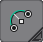
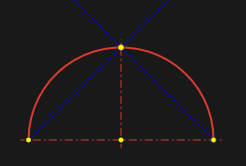
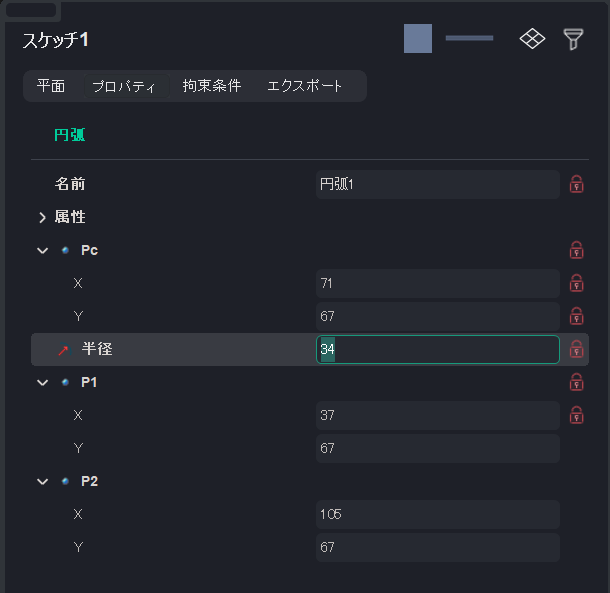
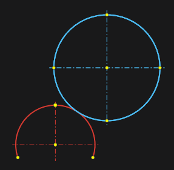

# Durch zwei Punkte und Radius

Um einen Bogen zu konstruieren, geben Sie nacheinander den ersten und zweiten Endpunkt sowie einen mittleren Punkt auf dem Bogen an.

Bogenparameter im **Property inspector** (Eigenschafteninspektor):

Beim Definieren eines Bogens können Sie Hilfslinien verwenden. Standardmäßig werden Hilfslinien vom ersten oder zweiten Punkt aus bei 0°, 45° und 90° angeboten. Im Bearbeitungsmodus werden zusätzlich der Kreismittelpunkt und die Mitte des Bogens berücksichtigt.

Darüber hinaus können Sie Hilfslinien erzeugen, indem Sie den Mauszeiger über einen Punkt eines bereits erstellten Objekts bewegen, wie beim Erstellen oder Bearbeiten einer Linie.

Wenn Sie im letzten Konstruktionsschritt bei gedrückter **Strg**-Taste (**Ctrl**) ein Liniensegment, einen Bogen oder einen Kreis auswählen, wird ein Bogen konstruiert, der dieses Element tangential berührt.

