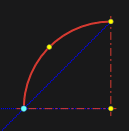

# Centro, punto iniziale e angolo

Per costruire un arco, specificare in successione il centro, il primo e il secondo punto dell'arco.

I parametri dell'arco e la loro fissazione sono del tutto analoghi al primo metodo di costruzione.

Le guide vengono proposte a partire dal centro (dopo averlo specificato) e poi, in aggiunta, dal primo punto dell'arco.

