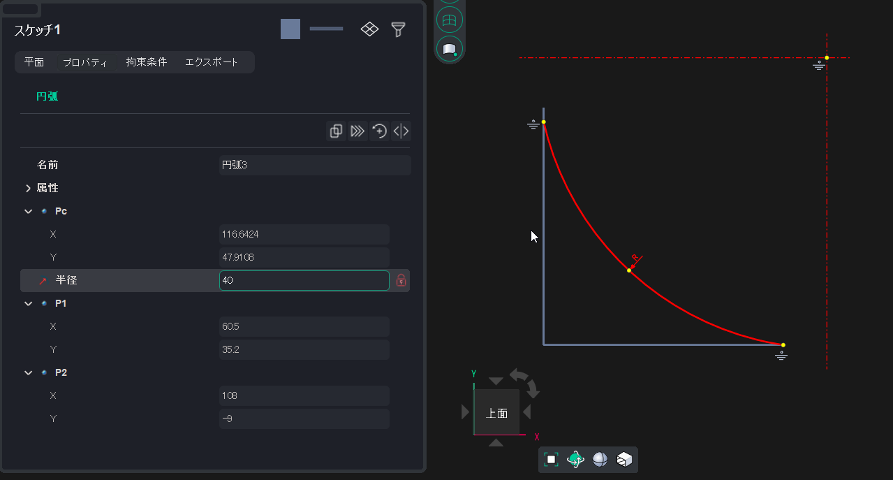

# Arc with three tangents

To construct an arc, you must sequentially specify three objects to which the arc should be tangent, with the **[Ctrl]** key pressed

Or specify two objects and enter the radius of the arc:

Points, lines, arcs and circles can be combined in any order. Clicking without **[Ctrl]** specifies a point, allowing construction through three points. A radius can replace the third element.
