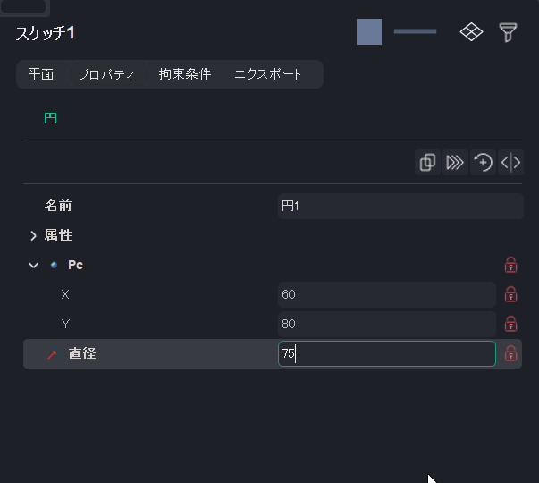
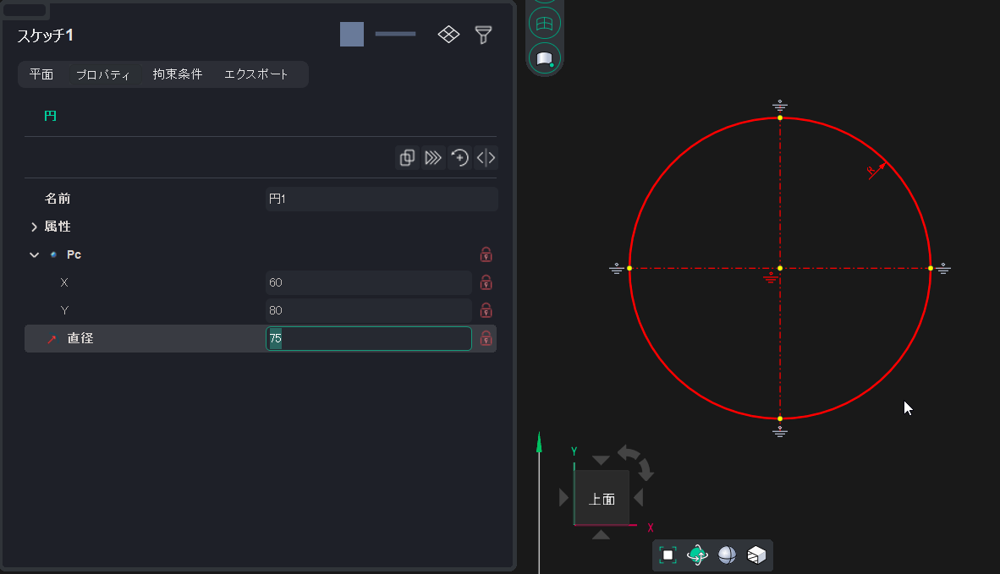
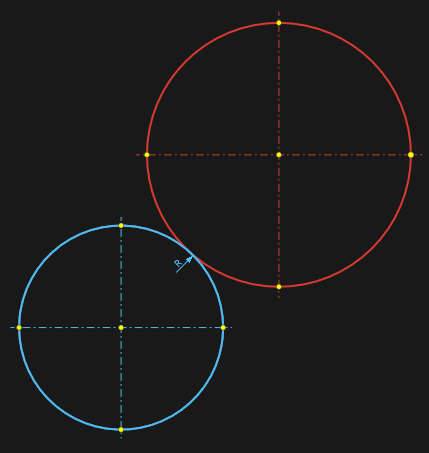

# Construção de círculo por centro e raio; edição de círculo

Para construir um círculo, você precisa especificar o ponto central com o cursor ou inserir as coordenadas no inspetor. Especifique o raio da mesma forma, interativamente, ou inserindo o valor do diâmetro no inspetor. Você também pode pressionar [R] para alternar para o modo de entrada de raio ou [D] para voltar ao modo de entrada de diâmetro.

Ao editar um círculo, você pode modificá-lo diretamente na janela gráfica, movendo os pontos do círculo ou alterando as propriedades do círculo no painel do inspetor. As linhas de eixo para o círculo podem ser adicionadas selecionando Line (Linha) e clicando duas vezes no círculo.

Parâmetros de círculo no **Inspetor de propriedades**:

Os valores dos parâmetros do círculo podem ser fixados clicando no botão "lock" (travar) no campo do editor ou clicando no ícone de restrição na janela gráfica.

Se for necessário construir um círculo com um determinado centro e uma tangente a outro objeto, pressione a tecla [Ctrl] ao especificar esse objeto.

Ao definir ou alterar um círculo, você pode usar a ajuda de linhas-guia. Por padrão, as guias são oferecidas em ângulos de 0°, 45° e 90° em relação ao ponto editado.
