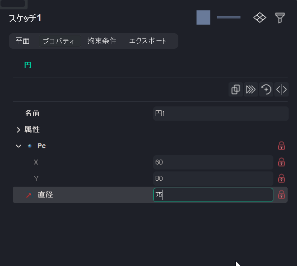
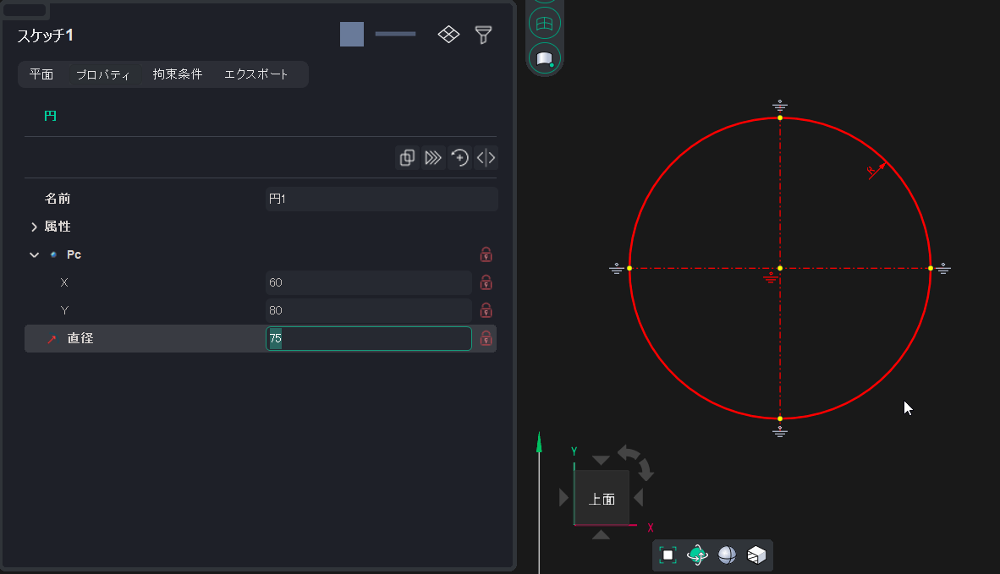
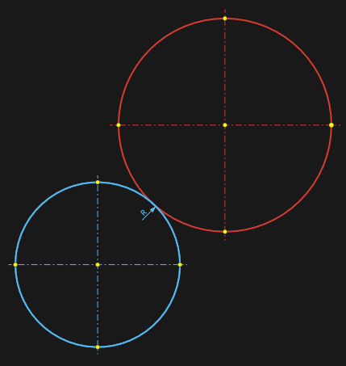

# 中心と半径で円を作図円編集

円を作成するには、カーソルで中心点を指定するか、インスペクターで座標を入力します。半径も同様に、インタラクティブに指定するが、またはインスペクターに直径の値を入力して、設定します。また、 <strong>[R]</strong> キーを押すと半径入力モードに切り替わり、 <strong>[D]</strong>キー を押すと直径入力モードに戻ります。

円を編集する際は、グラフィカルウィンドウで円のポイントを移動するか、インスペクターパネルで円のプロパティを変更することで、円を直接修正することができます。円の軸線は、 <strong>線</strong> を選択し、円をダブルクリックすることで追加することができます。

<strong>`プロパティインスペクター`</strong>内の円パラメータ：

円パラメータの値は、編集フィールドの「ロック」ボタンをクリックするか、グラフィックウィンドウの拘束アイコンをクリックして固定できます。

指定した中心を持ち、他のオブジェクトに接する円を作成する場合は、そのオブジェクトを指定する際に <strong>[Ctrl]</strong> キーを押してください。

円を定義または変更する際には、ガイド線を利用することができます。デフォルトでは、編集点から0°、45°、90°の角度でガイドが表示されます。
