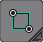
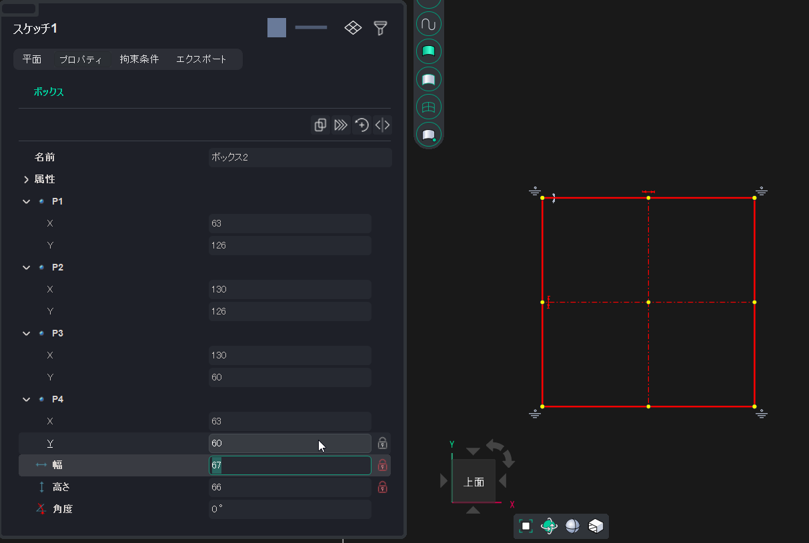

# Per due punti

Il rettangolo viene costruito specificando in modo interattivo due punti diagonali, oppure specificando nell'inspector le coordinate del primo punto e la larghezza/altezza del rettangolo. Un rettangolo può essere ruotato solo modificando l'angolo di rotazione nell'inspector.

Opzioni del rettangolo nella finestra <strong>Property inspector</strong> (ispettore delle proprietà):

Durante la definizione di un rettangolo è possibile avvalersi di linee guida. Per impostazione predefinita, le guide vengono proposte a partire dal punto in modifica e dal punto opposto con angoli di 0°, 45°, 90° e lungo una retta passante per tali punti.
