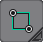
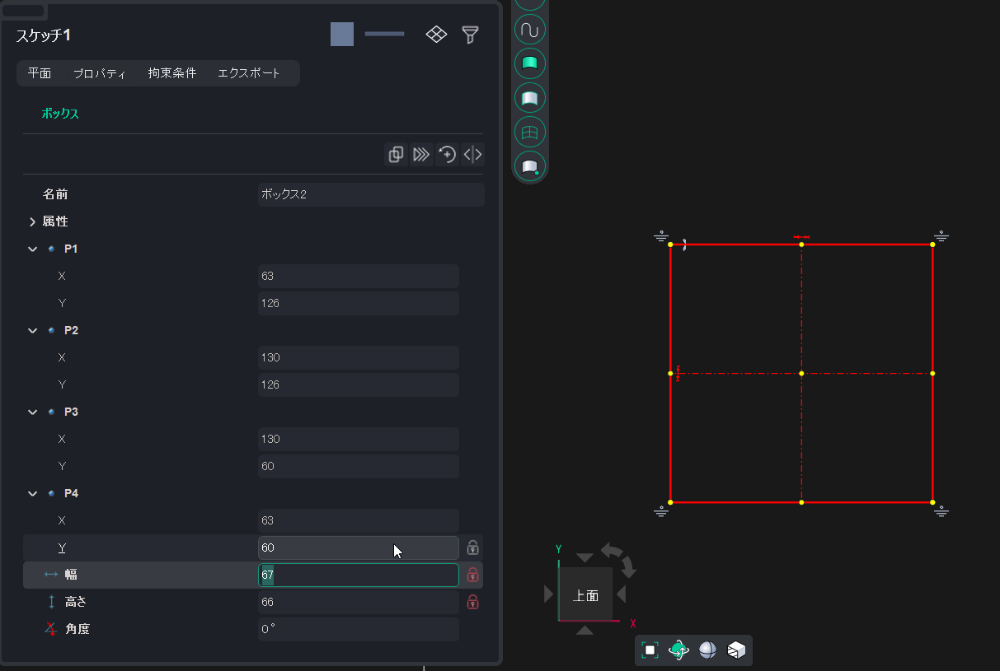

# 2点で作図

長方形は、対角の2点をインタラクティブに指定するか、インスペクターで最初の点の座標と幅、高さを指定することで作成できます。長方形を回転させるには、インスペクターで回転角度を変更します。

<strong>`プロパティインスペクター`</strong> ウィンドウ内の長方形オプション：

長方形を定義する際に、ガイドラインを利用することができます。デフォルトでは、編集中の点と反対側の点から、0°、45°、90°の角度、およびこれらの点を通る直線に沿ってガイドが表示されます。
