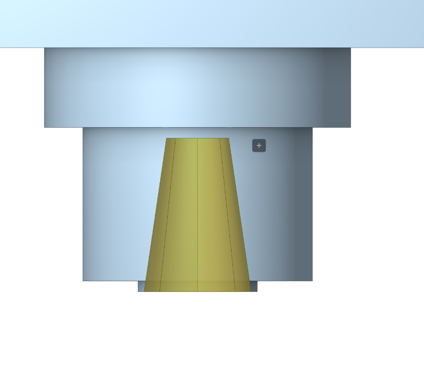
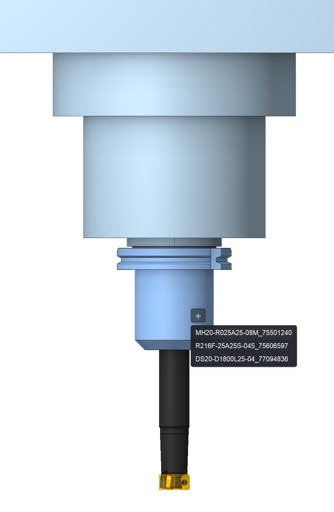
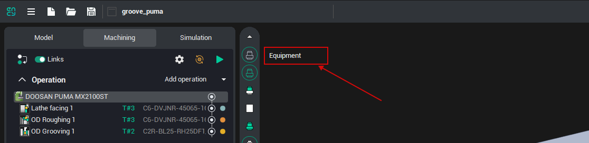

# 工具アセンブリ

  

## 適用分野:

工具アセンブリは、切削工具を1つ以上のアダプタに取り付け、それらを機械のマガジンに装着する一連の接続されたコンポーネントとして工具を定義する、CAMシステムの仕組みです。この仕組みにより、<strong>工具選択を自動化</strong>することができます。工具選択は、工程計画における重要なステップであり、加工工程を自動生成するための前提条件となります。

自動工程生成は、工具の自動選択を実現しなければ行うことができません。工具の自動選択を可能にするためには、以下の2つの条件を満たす必要があります。

• 工具がユーザーデータベースに登録されていること。

• 工具を機械のマガジンに正しく取り付けるためのアダプタが存在すること。

### 工具オペレーションモード

CAMシステムでは、工具を扱う際に以下の2つのモードをサポートしています。

<strong>• <strong>クラシック工具モード</strong> 工具を扱う際の標準的なモードです。

<strong>• アドバンス工具モード</strong> 工具アセンブリを使用して工具を扱うモードです。システムがアドバンストモードになっている場合、<strong>設備</strong>ボタンが加工ページに表示されます。

