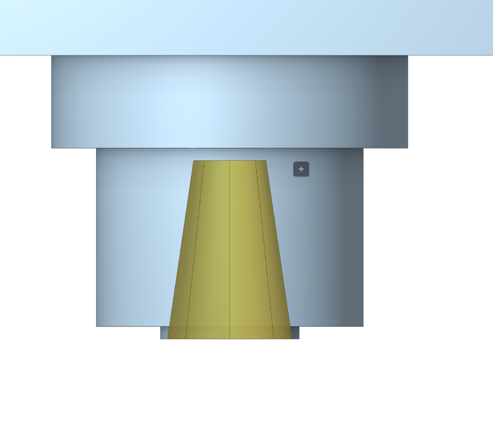
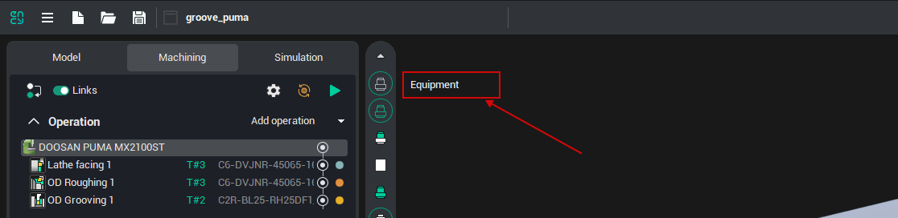

# Conjuntos de ferramentas

  

## Área de aplicação:

Os conjuntos de ferramentas são o mecanismo do sistema CAM para descrever o ferramental como um conjunto de componentes conectados: uma ferramenta de corte montada em um ou mais adaptadores, encaixados no magazine da máquina. O mecanismo foi projetado para **automatizar a seleção da ferramenta**, etapa essencial do planejamento do processo e pré-requisito para gerar automaticamente um processo de usinagem.

A geração automática do processo depende da solução da seleção automática da ferramenta. Para isso, duas condições devem ser atendidas:

- a ferramenta deve existir no banco de dados do usuário;
- deve existir um adaptador que garanta a montagem correta da ferramenta no magazine da máquina.

### Modos de operação das ferramentas.

O sistema CAM oferece dois modos de trabalho com ferramentas:

- **Classic tools mode.** Modo padrão de trabalho com ferramentas.
- **Advanced tools mode.** Modo de trabalho com conjuntos de ferramentas. Quando esse modo está ativo, o botão **Equipment** é exibido na página de tecnologia.

