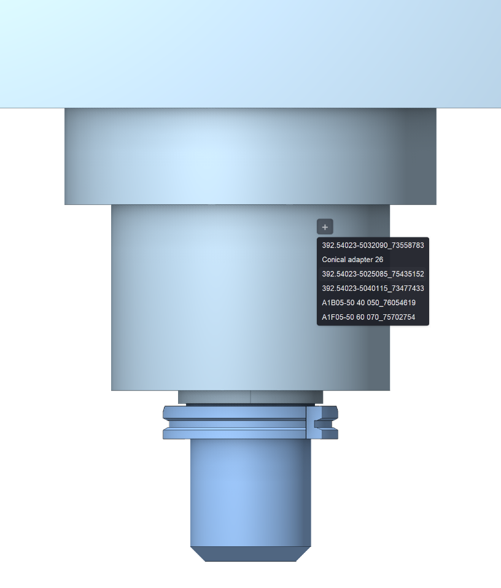
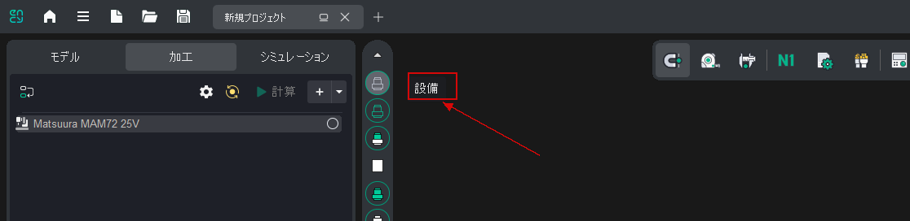

# Tool assemblies

  

## Application area:

Tool assemblies are the CAM system mechanism for describing tooling as a set of connected components — a cutting tool mounted into one or more adapters that plug into a machine magazine. The mechanism is designed to **automate tool selection**, which is an essential stage of process planning and a prerequisite for the automatic generation of a machining process.

Automatic process generation is not possible without solving the automatic tool selection task. For that task to be solvable, two conditions must hold:

- The tool must be present in the user database.

- An adapter must exist that ensures correct mounting of the tool into the machine magazine.

### Tool operation modes.

The CAM system supports two modes of working with tooling:

- **Classic tools mode.** The standard mode of working with tools.

- **Advanced tools mode.** The mode of working with tool assemblies. When the system is in advanced mode, the **Equipment** button is shown on the technology page.

### Saving and loading a tool set (`*.mke`)

In advanced tools mode the machine setup — the tool assemblies mounted on the machine together with their components — can be saved to a tool set file (`*.mke`) and loaded in another project. Use the drop-down menu of the **Tools** button on the top toolbar:

- **Save list of project tools as...** — saves the current machine setup to a `*.mke` file. The dialog suggests the last tool set of this machine or, if there is none, the project name.
- **Import tools to the project...** — opens a `*.mke` file and replaces the machine setup of the project with it. The tool operation mode does not change.
- **Delete all unused tools from the project** — removes the components that no operation uses.

The system remembers the last saved or opened tool set separately for each machine. When this machine is selected in a new project or the machine of a project is changed, the tool set is loaded automatically. In advanced tools mode only `*.mke` files are loaded, in classic mode only `*.tom` files ([Project tool list](10342.md)); a file of the other mode is skipped.
