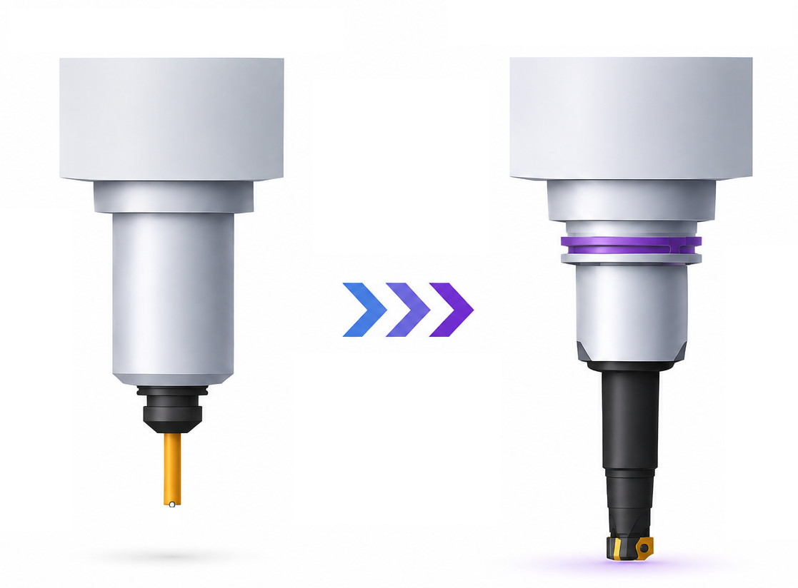
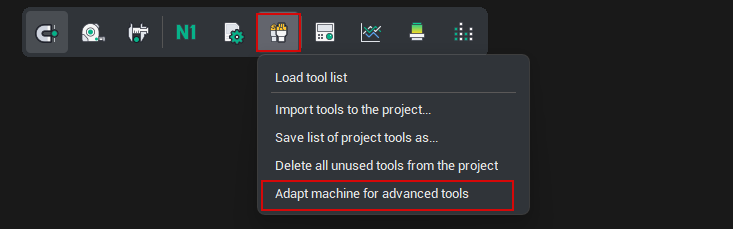
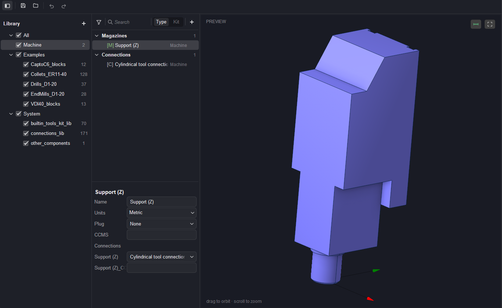
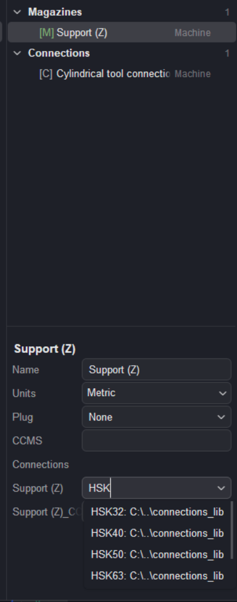
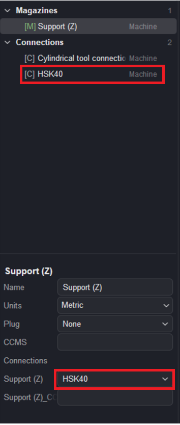
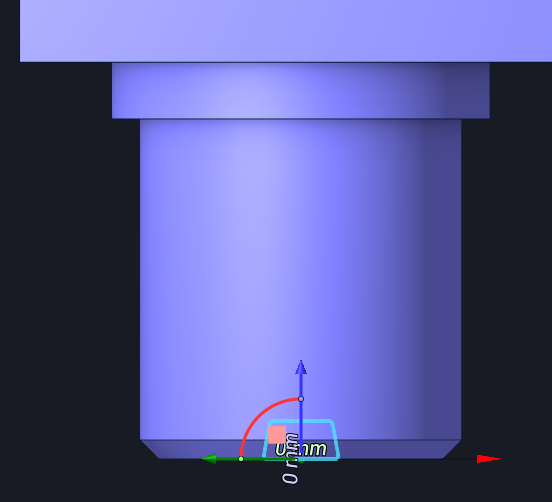

# 高度工具モード用に機械を適合させる

## 適用分野:

アドバンスモードに切り替えられるかどうかは、使用中の機械スキームによって決まります。旧形式（クラシック形式）の機械スキームは工具アセンブリを直接扱うことができないため、先に新しい形式へ適合させる必要があります。

適合は、アクティブな機械スキームがまだ適合されていない場合に工具メニューで使用できる<strong>高度工具用に機械を適合</strong>コマンドによって実行されます。適合中に、マシン<strong>ライブラリ（マシンキット）</strong>が作成されます。<strong>マシンキット</strong>ファイルは常に<strong>マシンスキーム</strong>ファイルの隣に配置され、マガジンという特殊なコンポーネントタイプを含みます（指定された接続タイプのソケットを持ち、プラグを持たないコンポーネント）。

機械が適合されると、コンポーネントライブラリウィンドウが開きます。このウィンドウには、工具アセンブリの取り付け位置を保持する機械ノード（マガジンコンポーネント）がすでに含まれています。初期状態では、機械ノードには標準接続（この場合は円筒工具接続）が割り当てられており、［接続］に表示され、ノードのサポート（Z）接続として設定されています。

<strong>接続の割り当て</strong> 接続は、必ずしも＋ボタンを使用してメニューから呼び出す必要はありません。接続フィールドに接続名を直接入力できます。値は候補から選択することも、新しい値として定義することもできます。フィールドに新しい名前を入力すると、新しい接続タイプが作成されます。

ライブラリから接続を選択した場合、そのすべての寸法は規格に従って考慮されます。

  

> 注記
>
> >
> ウィンドウを閉じると、機械の隣に *<strong>.mKIT</strong><strong>ファイル</strong>（セットアップファイル）が作成されます。このファイルには、その機械に関連付けられたすべての工具が含まれます。

<strong>クラシックモード</strong>へ戻す場合は、同じメニューから<strong>クラシック工具を有効化</strong>モードコマンドを実行します。
