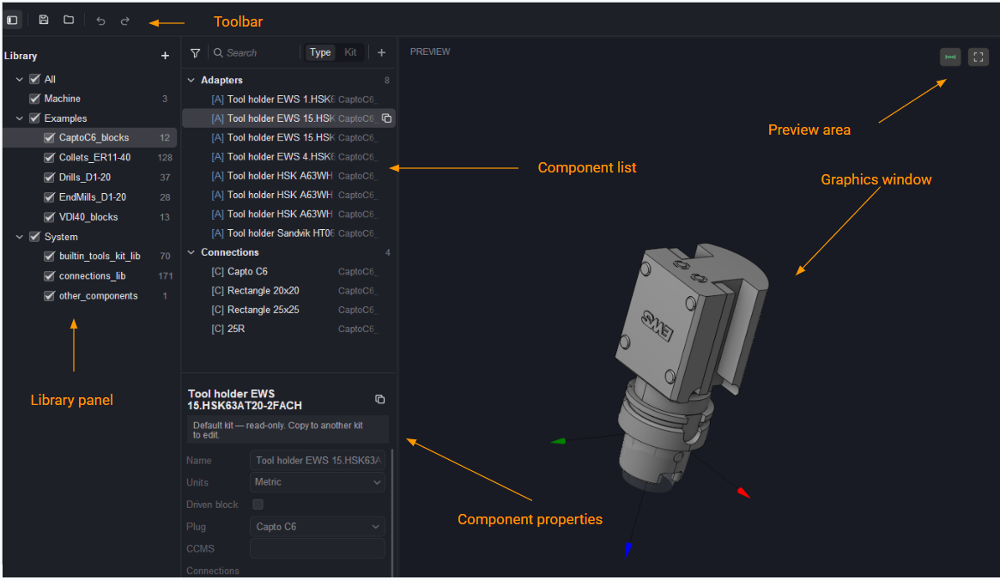

# コンポーネントライブラリ

## 適用分野:

<strong>コンポーネントライブラリ</strong>ウィンドウは、コンポーネントライブラリの編集画面です。コンポーネントライブラリは、工具アセンブリを構成する要素である切削工具、アダプタ、機械マガジン、およびそれらを接続する結合部を保管する場所です。各コンポーネントには視覚的な表示があり、寸法によって定義され、シャンク（<strong>プラグ</strong>）を持ちます。また、アダプタおよびマガジンには、特定の接続タイプを持つ1つ以上の座面（<strong>ソケット</strong>）があります。

このウィンドウは、自動工具選択および工具アセンブリ生成を可能にするための工具データを準備、保守するために使用します。

コンポーネントライブラリウィンドウは、対応するツールバーボタンから開きます。（<strong>アドバンスモード</strong>）

### コンポーネントライブラリは、次の要素で構成されます。

<strong>ツールバー（左上）</strong>

<strong>• <strong>パネルの表示切替</strong> 左側の<strong>ライブラリ</strong>パネルの表示／非表示を切り替えます。

<strong>• <strong>保存</strong> ライブラリファイルへの変更をディスクに保存します。

<strong>• <strong>開く</strong> ディスク上のライブラリファイルを開きます。

<strong>• <strong>元に戻す</strong> 直前の変更を取り消します。

<strong>• <strong>やり直し</strong> 取り消した変更を再実行します。

<strong>ライブラリパネル</strong>

<strong>•</strong> <strong>追加（+）</strong> 新しいユーザーライブラリをパネルに追加します。

<strong>• <strong>カテゴリ／ライブラリのチェックボックス</strong> コンポーネント一覧に表示するカテゴリ（すべて、マシン、サンプル、システム）または個別ライブラリの表示／非表示を切り替えます。

ライブラリは、ファイルとしてディスク上に保存されます。コンポーネントライブラリは、次のカテゴリに分類されます。

<strong>• すべて</strong> すべてのライブラリを一括表示する最上位ノードです。すべてのカテゴリとそのライブラリがまとめて表示されます。

<strong>• マシン</strong> 機械スキームを詳細工具モードで使用するために適応する際に作成されます。機械ライブラリファイルは、常に機械スキームファイルの隣に配置されます。このライブラリには、マガジンと呼ばれる特殊なコンポーネントタイプが含まれます。機械マガジンは、指定された接続タイプのソケットを持ち、プラグを持たないコンポーネントです。機械スキームが有効化されると、その隣にあるライブラリも自動的に有効化されます。

<strong>• サンプル</strong> ソフトウェアに付属する参照用ライブラリです。

<strong>• システム</strong> CAMシステムによって提供および管理されるライブラリです。

<strong>コンポーネント一覧（中央パネル）</strong>

- <strong>フィルター</strong> コンポーネント一覧のフィルタリングオプションを開きます（漏斗アイコン）。
- <strong>検索</strong> 入力したコンポーネント名で一覧を絞り込みます。
- <strong>タイプ</strong> コンポーネントタイプ（マガジン、接続、工具 など）別の表示グループに切り替えます。
- <strong>キット</strong> キット（元のライブラリ）別の表示グループに切り替えます。
- <strong>追加 (+)</strong> 現在のライブラリに新しいコンポーネントを作成します。

<strong>コンポーネントプロパティ（下部パネル）</strong>:</strong><em>（フィールド）</em> <strong>名前</strong>、<strong>単位</strong>、<strong>プラグ</strong>、<strong>CCMS</strong>、および<strong>接続</strong>一覧（<strong>サポート</strong> <strong>(Z)</strong> など）。

<strong>プレビュー領域</strong>

<strong>寸法を表示</strong> 3Dプレビュー内でコンポーネント寸法の表示／非表示を切り替えます。

<strong>全体表示</strong> ドラッグでモデルを回転し、スクロールホイールでズームします（<em>ドラッグでオービット</em> <em>·</em> <em>スクロールでズーム</em>）。

### ライブラリの作成

コンポーネントライブラリへの登録には、次の作業が含まれます。

<strong>•</strong> <strong>組み込みパラメータ化コンポーネントの作成 プラグ</strong>および<strong>ソケット</strong>には、標準接続を優先して入力する必要があります。

<strong>• 3D</strong><strong>モデルからのオブジェクト作成</strong> フィルターで使用するフィールドを入力する必要があります。

<strong>•</strong> <strong>フィルターの操作</strong> フィルター項目は、適切なコンポーネントを検索するために使用されます。
