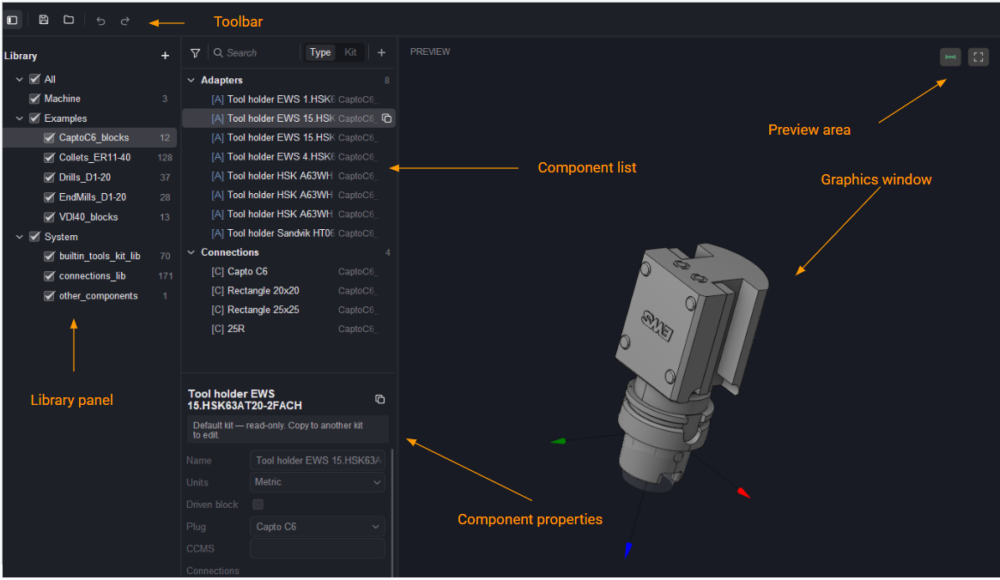

# コンポーネントライブラリ

## 適用分野:

<strong>コンポーネントライブラリ</strong>ウィンドウは、コンポーネントライブラリの編集画面です。コンポーネントライブラリは、工具アセンブリを構成する要素である切削工具、アダプタ、機械マガジン、およびそれらを接続する結合部を保管する場所です。各コンポーネントには視覚的な表示があり、寸法によって定義され、シャンク（<strong>プラグ</strong>）を持ちます。また、アダプタおよびマガジンには、特定の接続タイプを持つ1つ以上の座面（<strong>ソケット</strong>）があります。

このウィンドウは、自動工具選択および工具アセンブリ生成を可能にするための工具データを準備、保守するために使用します。

コンポーネントライブラリウィンドウは、対応するツールバーボタンから開きます。（<strong>アドバンスモード</strong>）

### コンポーネントライブラリは、次の要素で構成されます。

<strong>ツールバー（左上）。</strong>

- <strong>パネル表示切替。</strong> 左側の<strong>ライブラリ</strong>パネルを表示／非表示にします。

- <strong>保存。</strong> ライブラリファイルの変更をディスクに保存します。

- <strong>開く。</strong> ディスクからライブラリファイルを開きます。

- <strong>元に戻す。</strong> 直前の変更を取り消します。

- <strong>やり直し。</strong> 取り消した変更を再実行します。

<strong>ライブラリパネル。</strong>

- <strong>追加（＋）。</strong> パネルに新しいユーザーライブラリを追加します。

- <strong>カテゴリ／ライブラリのチェックボックス。</strong> 構成要素リストで、カテゴリ（<strong>すべて</strong>、<strong>マシン</strong>、<strong>サンプル</strong>、<strong>システム</strong>）または個別のライブラリの表示を切り替えます。

ライブラリは、ディスク上にファイルとして保存されます。構成要素ライブラリには、次のカテゴリがあります。

- <strong>すべて。</strong> 全ライブラリを一括表示する最上位ノードです。すべてのカテゴリとそのライブラリをまとめて表示します。

- <strong>マシン。</strong> マシンスキーマを<strong>アドバンスト工具モード</strong>向けに適合させる際に作成されます。マシンライブラリファイルは常に<strong>マシンスキーマファイル</strong>と同じ場所にあります。このライブラリには、マガジンと呼ぶ特殊な構成要素が含まれます。マシンマガジンは、指定した接続タイプのソケットを持ち、プラグを持たない構成要素です。マシンスキーマを有効にすると、同じ場所にあるライブラリも自動で有効になります。

- <strong>サンプル。</strong> ソフトウェアに付属する参照用ライブラリです。

- <strong>システム。</strong> CAMシステムが提供・管理するライブラリです。

<strong>コンポーネント一覧（中央パネル）</strong>

- <strong>フィルター</strong> コンポーネント一覧のフィルタリングオプションを開きます（漏斗アイコン）。
- <strong>検索</strong> 入力したコンポーネント名で一覧を絞り込みます。
- <strong>タイプ</strong> コンポーネントタイプ（マガジン、接続、工具 など）別の表示グループに切り替えます。
- <strong>キット</strong> キット（元のライブラリ）別の表示グループに切り替えます。
- <strong>追加 (+)</strong> 現在のライブラリに新しいコンポーネントを作成します。

<strong>構成要素のプロパティ（下部パネル）：</strong> <em>（ボタンではなくフィールド）</em> <strong>名前</strong>、<strong>単位</strong>、<strong>プラグ</strong>、<strong>CCMS</strong>、および<strong>接続</strong>リスト（<strong>サポート（Z）</strong>など）。

<strong>プレビュー領域</strong>

<strong>寸法を表示</strong> 3Dプレビュー内でコンポーネント寸法の表示／非表示を切り替えます。

<strong>全体表示</strong> ドラッグでモデルを回転し、スクロールホイールでズームします（<em>ドラッグでオービット</em> <em>·</em> <em>スクロールでズーム</em>）。

### ライブラリの作成

構成要素ライブラリにデータを登録する作業には、次のものがあります。

- <strong>組み込みのパラメトリック構成要素の作成。</strong> <strong>プラグ</strong>と<strong>ソケット</strong>を設定する必要があります。標準接続の使用を推奨します。

- <strong>3Dモデルからのオブジェクト作成。</strong> フィルターで使用するフィールドを設定する必要があります。

- <strong>フィルターの操作。</strong> フィルターのフィールドにより、適切な構成要素を検索します。
