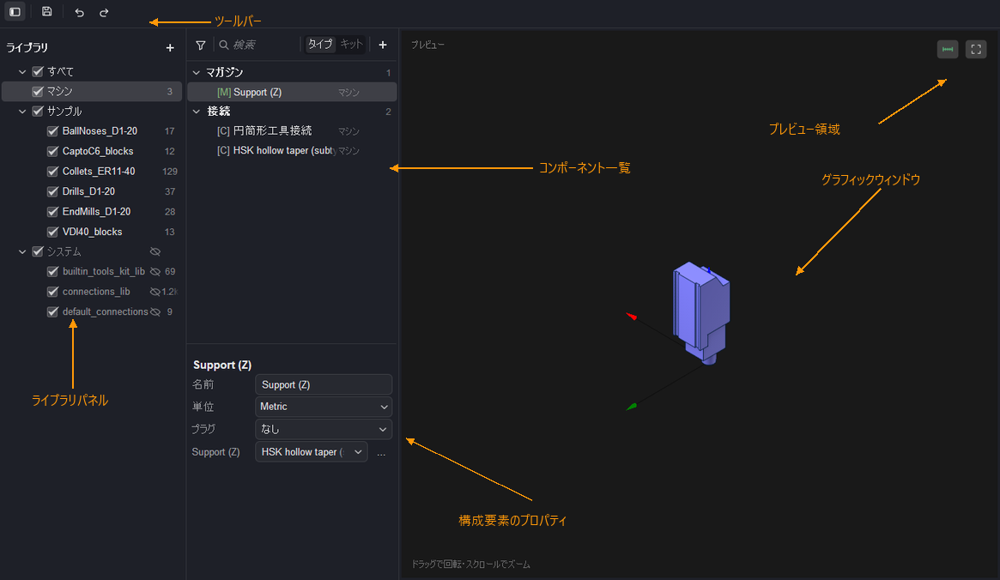

# Component libraries

## Application area:

The **Component libraries** window is the editor for component libraries — the storage where the building blocks of tool assemblies are kept: cutting tools, adapters, machine magazines, and the connections that join them. Each component has a visual representation, is defined by its dimensions, and carries a shank (**Plug**) and, for adapters and magazines, one or more seats (**Sockets**) of a specific connection type.

The window is used to prepare and maintain the tooling data that makes automatic tool selection and tool-assembly formation possible.

The component library window is opened by the corresponding toolbar button (in **advanced mode**).

### Component libraries consist of the following components:

**Toolbar (top-left).**

- **Toggle panel.** Shows or hides the left **Library** panel.

- **Save.** Saves changes to the library file on disk.

- **Open.** Opens a library file from disk.

- **Undo.** Cancels the last change.

- **Redo.** Repeats the previously cancelled change.

**Library panel.**

- **Add (+).** Adds a new (user) library to the panel.

- **Category / library checkboxes.** Toggle the visibility of a category (**All**, **Machine**, **Examples**, **System**) or an individual library in the component list.

A library is stored on disk as a file. Component libraries fall into the following categories:

- **All.** The top-level node that shows all libraries at once — every category and its libraries are displayed together.

- **Machine.** Formed during adaptation of a machine scheme for work in **advanced tools mode.** A machine library file always resides next to the **machine scheme file**. Such a library contains a special component type called a magazine. A machine magazine is a component that has sockets with a specified connection type and has no plug. When a machine scheme is activated, the library located next to it is activated automatically.

- **Examples.** Reference libraries supplied with the software.

- **System.** Libraries supplied and maintained by the CAM system.

**Component list (central panel).**

- **Filter.** Opens filtering options for the component list (funnel icon).
- **Search.** Filters the list by the entered component name.
- **Type.** Switches the list grouping to view by component type (Magazines, Connections, Tools, …).
- **Kit.** Switches the list grouping to view by kit (source library).
- **Add (+).** Creates a new component in the current library.

**Component properties (lower panel):** *(fields, not buttons)* **Name**, **Units**, **Plug**, **CCMS**, and the **Connections** list (**Support (Z)**, …).

**Preview area.**

**Show dimensions.** Toggles the display of component dimensions in the 3D preview.

**Zoom to fit.** The model is rotated by dragging and zoomed with the scroll wheel (*drag to orbit · scroll to zoom*).

### Forming libraries.

Filling a component library covers the following activities.

- **Creating built-in parameterized components.** The **Plug** and **Sockets** must be filled in, preferably with standard connections.

- **Creating objects from 3D models.** The fields used by filters must be filled in.

- **Working with filters.** Filter fields drive the search for suitable components.
