# 工具アセンブリの作成

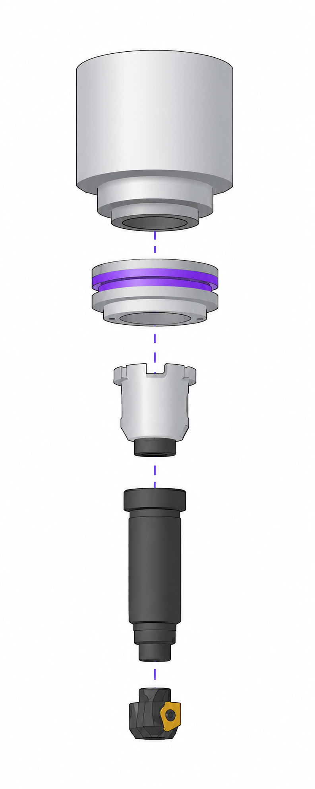

## 適用分野:

この例では、<strong>コンポーネントライブラリウィンドウ</strong>で単純なアセンブリを作成する手順を示します。ミーリング工具を、機械マガジンに取り付けるアダプタへ接続します。アセンブリは、切削工具から機械取付部へ向かって、ボトムアップ方式で作成します。

### コンポーネントを追加し、認識結果を確認する

3Dモデルからコンポーネントを追加します。システムは、読み込まれたモデルが工具かアダプタ（ホルダ）か、また工具の場合は工具タイプの<strong>自動認識を試みます</strong>。認識結果は、<strong>アダプタ／旋盤工具／Mill工具</strong>タブでユーザーが修正できます。工具タイプは、<strong>工具タイプフィールド</strong>で詳細に設定します。コンポーネントおよびその寸法はプレビューに表示されます。

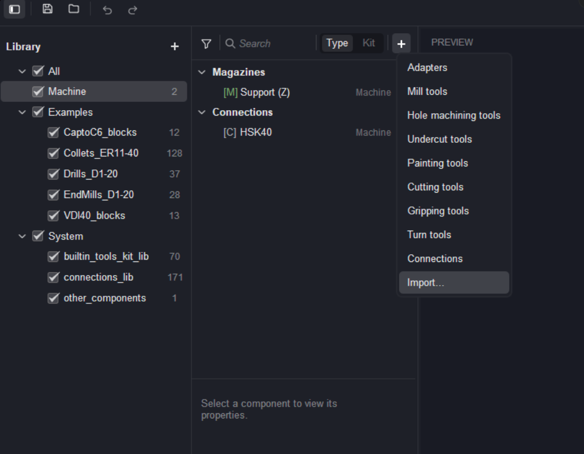 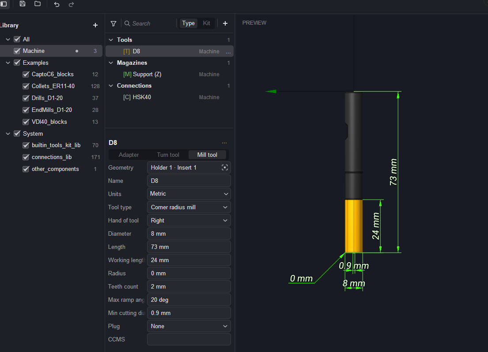

### 工具プラグを割り当てる

工具をアダプタに挿入できるようにするには、工具にシャンクが必要です。接続名は<strong>プラグ</strong>フィールドに入力します。候補から選択することも、新規に定義することもできます（ここでは D8）。ライブラリから接続を選択した場合、すべての寸法は規格に従って設定されます。

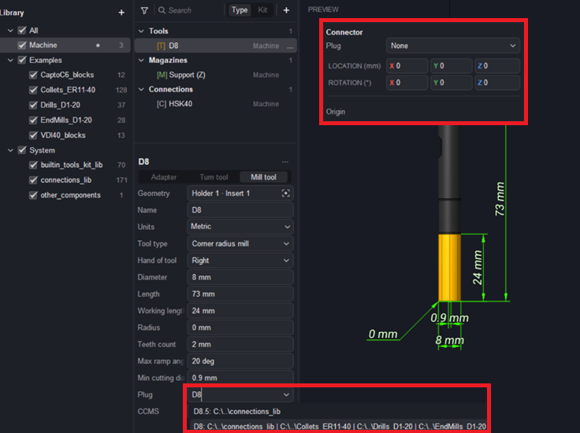

### プラグ接続を確認し、位置を調整する

<strong>プラグ</strong>を割り当てると、<strong>コネクタパネル</strong>が使用可能になります。このパネルには、<strong>接続プラグ</strong>、<strong>位置</strong>、<strong>回転</strong>、および<strong>原点コントロール</strong>が表示されます。さらに、接続固有のプロパティとして、タイプ（円柱）、高さ（20 mm）、直径（8 mm）、軸（Z）が表示されます。プラグはプレビュー内のモデル上で強調表示されます。<strong>原点</strong>を使用して、コネクタをコンポーネントに対して正しい位置に配置します。この操作は、<strong>+Z</strong><strong>／−Z</strong> <strong>コントロール（および上／下）</strong>を使用するか、プレビュー内の<strong>座標系</strong>をドラッグして行います。

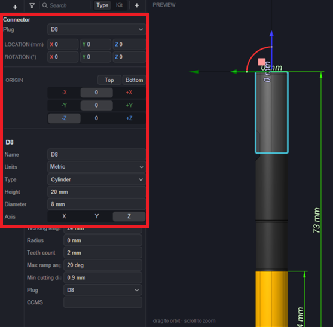

### アダプタを作成する

再度、追加（+）ボタンをクリックし、<strong>アダプタ</strong>を選択します。新しいアダプタがアダプタグループに追加されます。

### アダプタのプラグを設定し、ソケットを追加する

アダプタには 2 つの接続が必要です。1 つは機械に取り付けるための<strong>プラグ</strong>、もう 1 つは工具を受け入れるための<strong>ソケット</strong>です。アダプタのプロパティで、プラグフィールドには機械マガジンへアダプタを取り付ける接続を設定します（ここでは HSK40）。接続セクションでは、ソケット 1 に工具のプラグと同じ接続タイプである D8 を設定します。この例では、プラグとソケットの両方をリストから選択します。

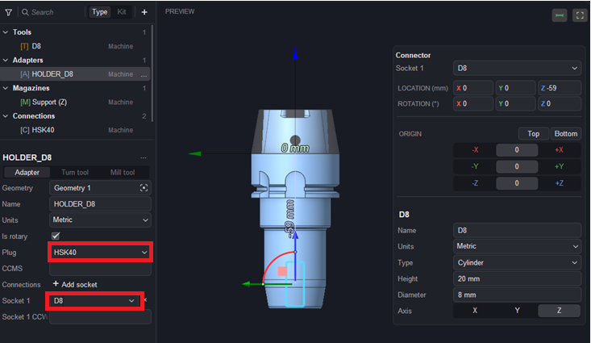

### オペレーションでの自動アセンブリ

コンポーネントがライブラリで使用可能になると、システムは既存のコンポーネントからオペレーション用の工具アセンブリを自動的に作成しようとします。オペレーションの<strong>工具アセンブリパネル</strong>には、工具（D8）、アダプタ（HOLDER_D8）、マガジン位置、補正番号（自動）で構成されたアセンブリが表示されます。組み立てられた工具は機械に取り付けられ、グラフィック領域に表示されます。

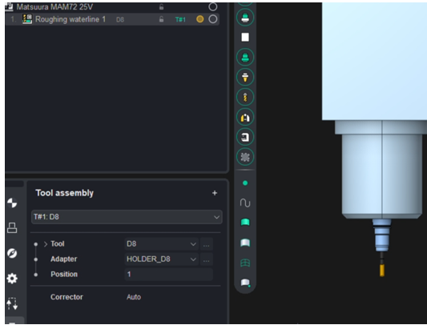

### 結果

アセンブリが完了し、オペレーションで使用できる状態になります。D8 工具は共通の D8 接続を介して HOLDER_D8 アダプタに挿入され、アダプタは HSK40 接続を介して機械マガジンに取り付けられます。システムは、アクティブなライブラリ内で検出されたコンポーネントから、この一連の接続を自動的に組み立てます。

### 工具ウィンドウから手動でアセンブリを作成する

工具アセンブリは手動でも作成できます。オペレーションの工具アセンブリパネルで<strong>+</strong>ボタンをクリックすると、<strong>新規追加パネル</strong>が開き、ここでアセンブリを構成します。対象のオペレーションに対して、システムは一致するアセンブリ候補を提示します。各候補には、名称、直径、作業長、および参照元ライブラリが表示されます（例: 8 mm エンドミル — Examples、D8 — Machine、7 mm エンドミル — Examples）。選択したアセンブリは機械に取り付けられ、グラフィック領域に表示されます。

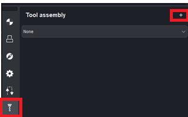 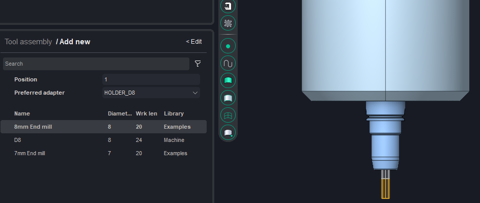

### 機械から直接アセンブリを作成する

アセンブリは、グラフィック領域で機械側から工具側へ向かって直接作成することもできます。機械上の空きソケットが表示されます。空きソケットをクリックすると<strong>+</strong>ボタンが表示されます。このボタンをクリックすると、接続タイプが一致するコンポーネントの一覧が開きます。まず、機械ソケットにアダプタ（ここでは HOLDER_D8）を追加します。次に、アダプタの空きソケット上の<strong>+</strong>ボタンをクリックし、提示された工具タイプ（ミル工具、穴加工工具）およびモデル（D8、7 mm エンドミル、8 mm エンドミル）から工具を選択します。アセンブリの作成後、そのアセンブリはオペレーションの工具アセンブリ一覧（例: T#1 8 mm エンドミル、T#2 D8）で使用可能となり、オペレーションに選択できます。

 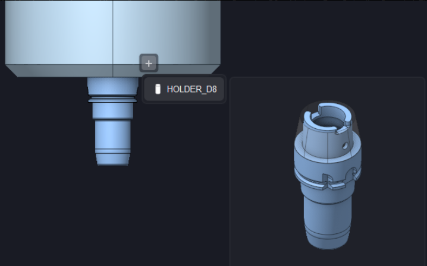 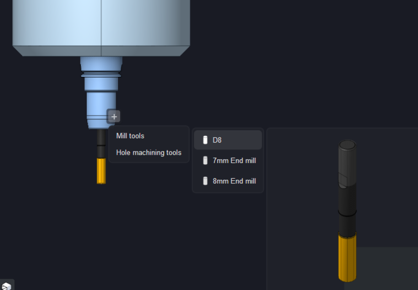 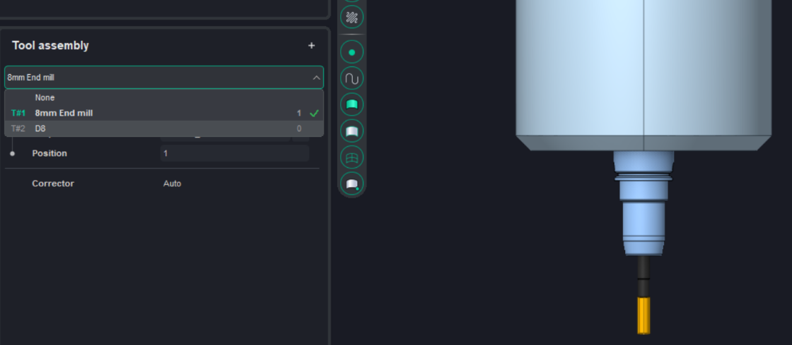
