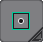

# Box with center

In this method, the center of the rectangle is specified first, and then one of the points of the rectangle.

The center is shown only before the first click. After that, the inspector provides **P1**…**P4** (vertex coordinates), **Width**, **Height** and **Angle**.
