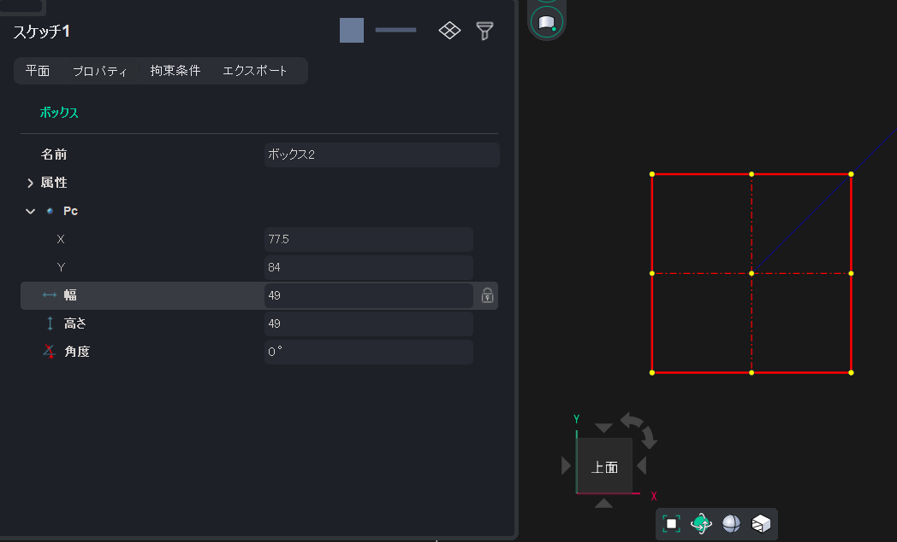

# Retângulo por centro e ponto

Nesse método, o centro do retângulo é especificado primeiro e, em seguida, um dos pontos do retângulo.

O inspetor exibe esse centro, bem como a largura, a altura e a rotação do retângulo.
