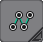
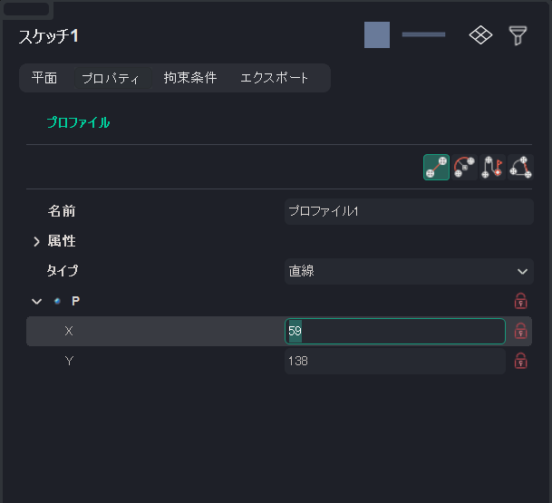
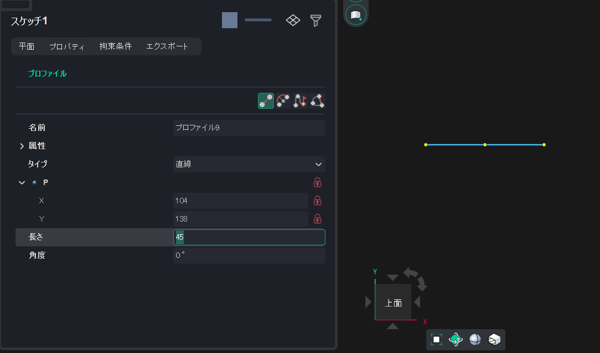
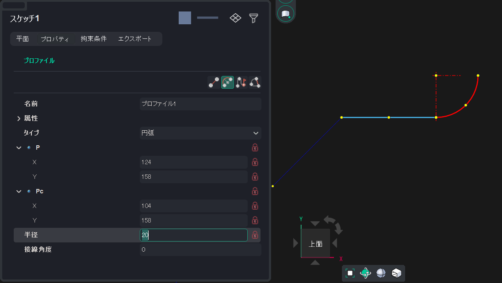
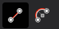
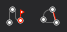

# Construção por elementos

A construção é realizada por meio da construção sucessiva de linhas/arcos, especificando pontos interativamente ou por meio do inspetor.

Na primeira etapa, você precisa especificar o ponto inicial do contorno ou inserir suas coordenadas no inspetor.

Em seguida, você também precisa especificar o próximo ponto ou inserir o comprimento e o ângulo da linha.

Ou especifique um arco. As coordenadas do próximo ponto e o ponto central do arco, seu raio e ângulo em relação à tangente do elemento anterior estarão disponíveis no inspetor.

Para alternar entre um segmento e um arco (e vice-versa), pressione o botão apropriado:

Ou pressione <strong>[Ctrl+Space]</strong>.

Conclua a definição do contorno clicando duas vezes no ponto final ou clique em um dos botões:

 termina o contorno pelo último elemento confirmado;  cria um contorno fechado conectando o último ponto confirmado ao primeiro com o tipo de elemento selecionado atualmente.

Também é possível encerrar a construção clicando duas vezes com o botão do mouse ao construir o último elemento
