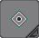
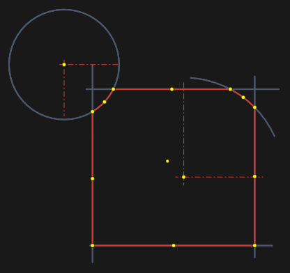
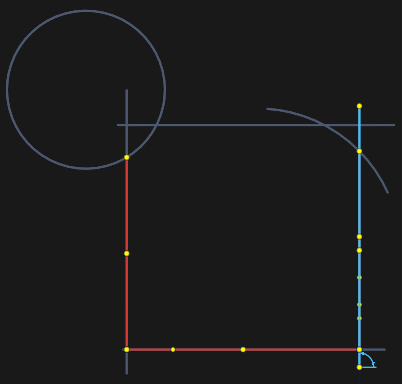
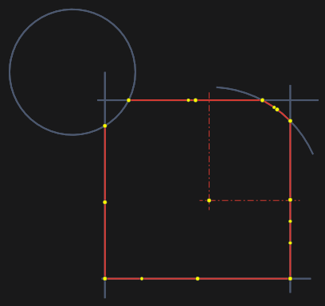

# Per zona o per contorno di delimitazione

In questo metodo il contorno viene costruito sugli elementi già esistenti.

Quando si specifica un punto all'interno di un gruppo di elementi, viene creato un contorno. I componenti di questo contorno si trovano in tale zona.

Quando si seleziona il bordo del contorno, i suoi elementi vengono creati automaticamente lungo la catena fino alla più vicina intersezione con un altro oggetto.

Per proseguire il contorno, selezionare il suo elemento successivo. Se l'elemento specificato non è collegato a quello costruito in precedenza, il sistema tenterà di completarlo lungo la catena.

