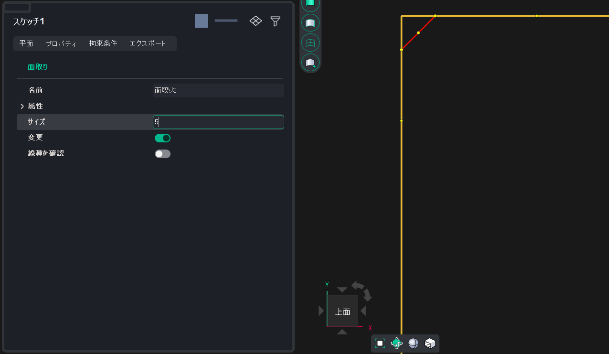
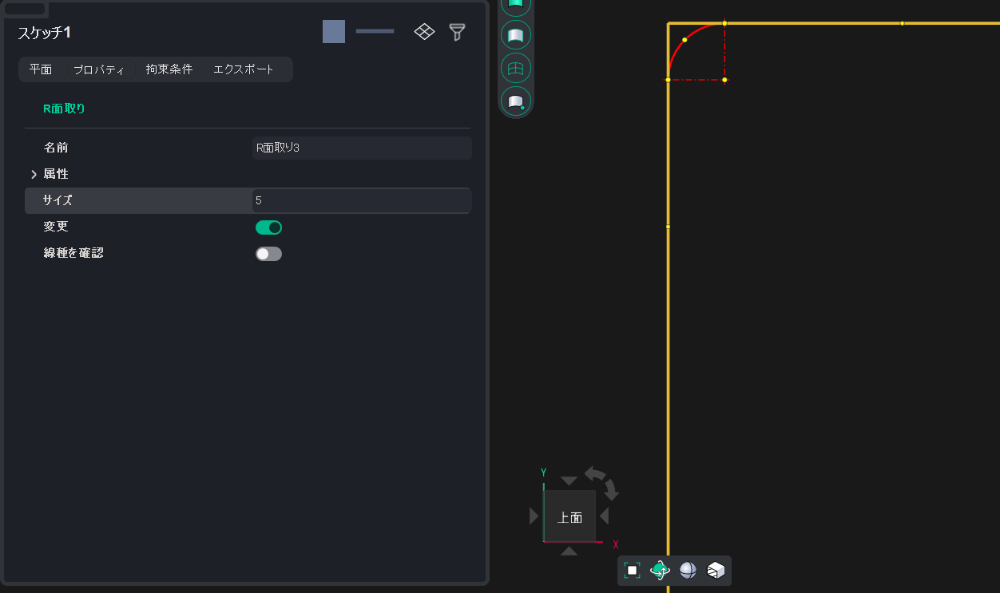
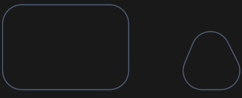

# Fase und Verrundung

Diese beiden Elemente werden automatisch konstruiert. Bewegen Sie den Mauszeiger zum Schnittpunkt der beiden Objekte, geben Sie die gewünschte Größe ein und klicken Sie, um die Konstruktion abzuschließen. Wenn das System das gewünschte Element nicht automatisch erstellen kann, wählen Sie die beteiligten Elemente nacheinander aus.

**Chamfer (Fase)**

**Rounding (Verrundung)**

Fasen und Verrundungen können auch zwischen Bögen erstellt werden.

Durch einen Doppelklick auf ein Rechteck oder eine Kontur werden alle Ecken dieses Elements verrundet.

