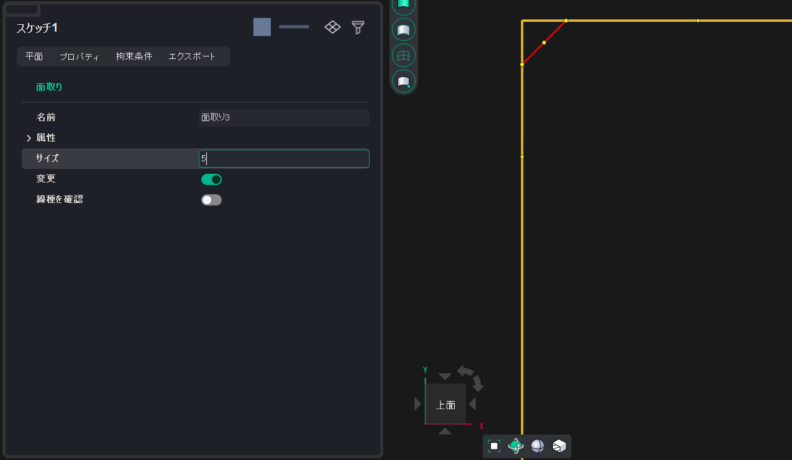

# 面取りとフィレット

これらの2つのオブジェクトは自動的に作成されます。2つのオブジェクトの交点にカーソル移動させ、サイズ値を入力し、マウスボタンをクリックするだけで作図が完了します。何らかの理由でシステムが必要なオブジェクトを作成できない場合は、対象となるオブジェクトを順番に選択する必要があります。

<strong>面取り</strong>

<strong>フィレット</strong>

円弧の間にも面取りやフィレットをつけることができます。

長方形や輪郭をダブルクリックすると、そのオブジェクトのすべての角が丸くなります。

