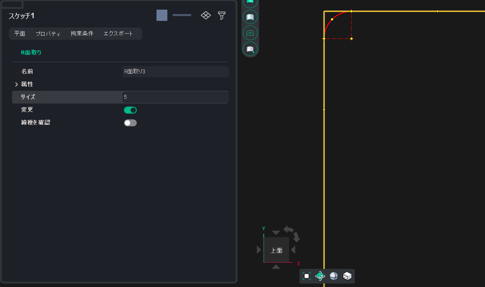
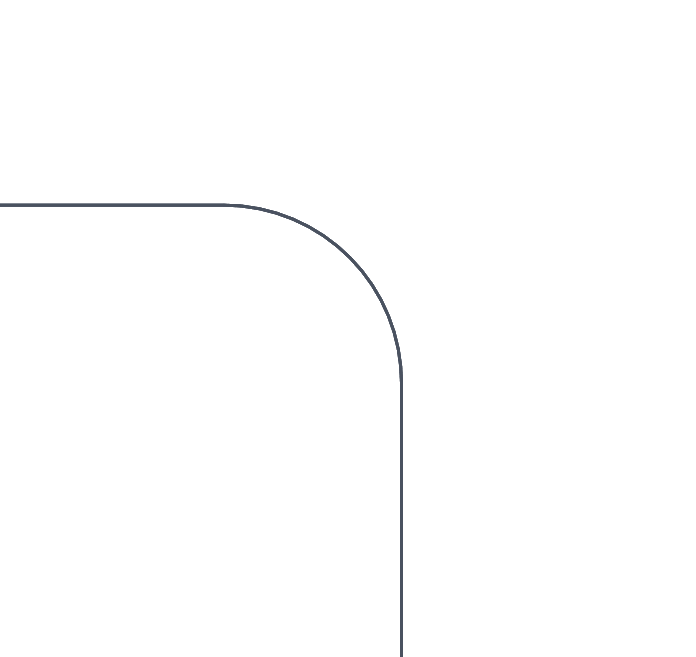
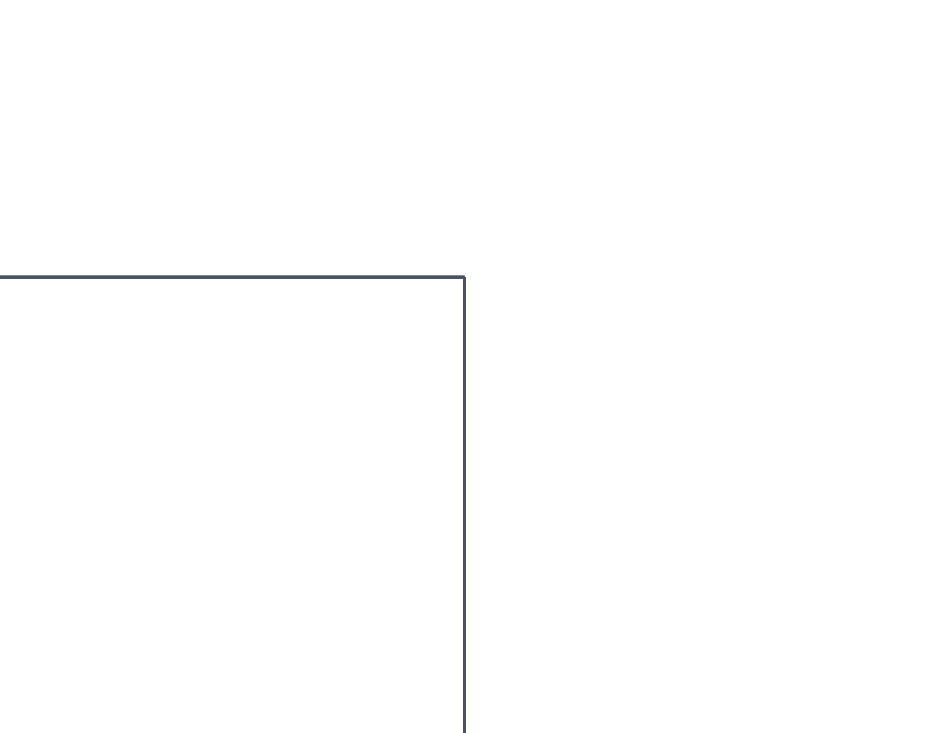
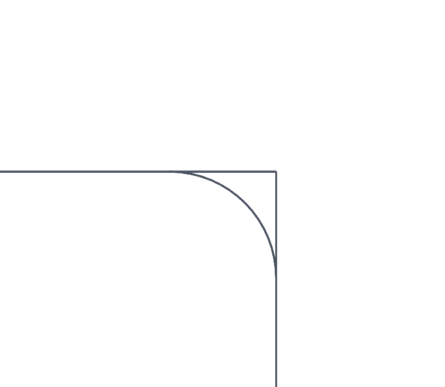

# Chamfer and Rounding

These two objects are built automatically. You just need to move the cursor to the intersection of two objects, enter the size value and click the mouse button to complete the construction. If for some reason the system cannot build the required element, then the elements must be sequentially selected.

**Chamfer**

**Rounding**

It is also possible to build chamfers and roundings between arcs.

If you double-click on a rectangle or contour, then all corners of such element will be rounded.

The button menu provides **Round chamfer with 2 elements** and **Chamfer with 2 elements**. Select a command, then select the two base elements in sequence.

**Modify.** **ON** by default: both base elements are trimmed to the chamfer or rounding and linked to it. When **OFF**, only a line or arc is created; the base elements remain unchanged.

**Check line type.** **OFF** by default. When creating a chamfer or rounding by clicking a corner, enabling this option restricts the base elements to the current line type selected above the inspector.

