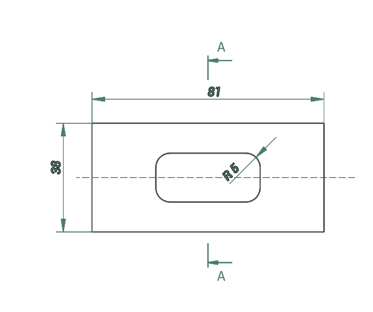

# Dimension

There are three types of dimensions for dimensioning sketches: [linear](20018.md), [radial](20019.md) and [angular](20020.md).

## Dimension value

**Hide value.** Hides the number on the dimension.

**Override value.** Makes the number independent and editable without changing the geometry. The value lock is released.

**Decimal places.** **auto** or a value from 0 to 6.

**Upper deviation**, **Lower deviation**. Entered in the two cells of the tolerance row.

**Value lock.** A locked value holds the geometry. Click the lock icon to toggle it. [Details](20031.md)

## Dimension menu commands

**Auto dimension.** Adds missing dimensions to the selected block or element. With no selection, it applies to the entire sketch.

**Show dimensions.** Controls dimension visibility. Hiding dimensions interrupts dimension creation.

## PMI font

The **PMI font** row in the dimension menu contains a checkbox and **+** and **−** buttons.

- **ON** (default): labels keep a constant screen size and always face the viewer, like dimensions in the 3D view.
- **OFF**: labels are sized in sketch millimeters and scale with the sketch, as on a printed drawing.

The **+** and **−** buttons work only when the checkbox is enabled. Each step changes the size by 10 %, within approximately 0.56 to 2.6 times the original size. This is an application-wide setting and is not saved in the project.
