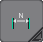
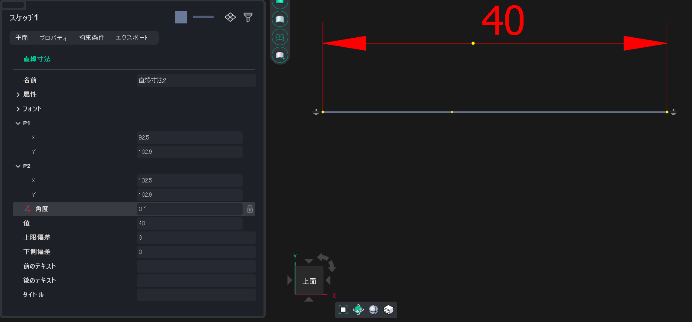
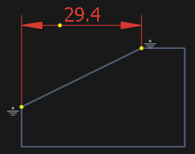

# 直線寸法

直線寸法を作成する際は、始点と終点、引出線の長さ、および最初の補助線に対する寸法テキストの開始位置のオフセットを指定する必要があります。寸法値は自動的に計算されます。インスペクターは、寸法線のX軸に対する傾き、上限および下限の偏差の値、寸法値の前後に表示するテキスト、およびテキストのフォントを設定します。

既存の線を指定して直線寸法を作成することも可能です。この場合、始点と終点を指定する必要はなく、寸法と線は関連付けられます。 その後、線または寸法を編集すると、両方のオブジェクトに変更が反映されます。

寸法線が水平または垂直でもない場合に、これを正規化する必要がある場合は、 寸法を作成する際に<strong>[Shift]</strong> キーを押しながら操作してください。

