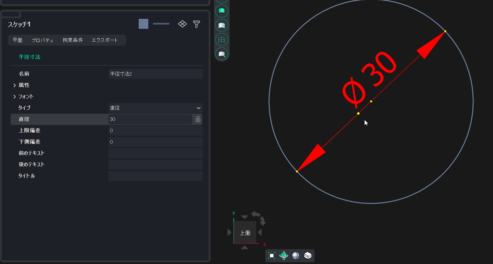
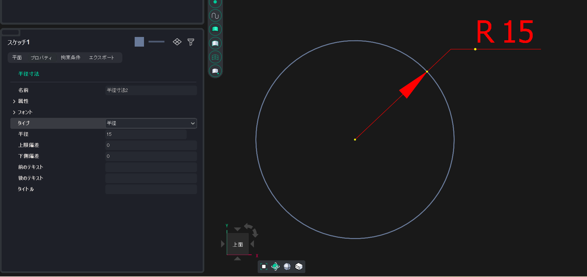

# 半径寸法

半径寸法を作成するには、既存の円または円弧とテキストの開始点を指定する必要があります。寸法値は自動的に決定されます。インスペクターでは、上限および下限の公差、寸法値の前後に表示するテキスト、およびテキストのフォントを設定します。

円に寸法を記入する場合、デフォルトでは、上の図のように <strong>直径</strong> タイプの寸法が作成されます。円弧の寸法を記入する場合は、デフォルトでは <strong>半径</strong> タイプの寸法が作成されます。

寸法のタイプは、同名のフィールドで変更することができます。

直線寸法の場合と同様に、システムはこれらのオブジェクトの関連付けを自動的に判断し、いずれか一方のオブジェクトを編集すると、もう一方のオブジェクトも変更されます。
