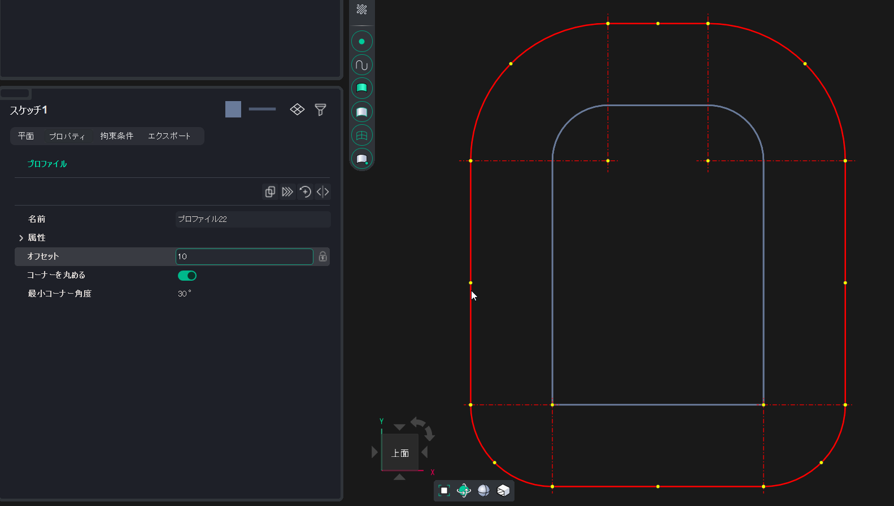
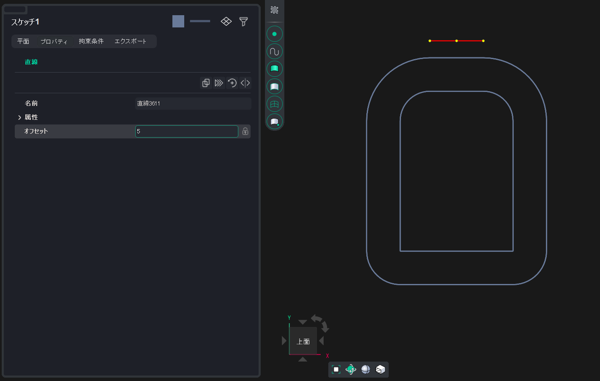

# オフセット

この機能は、既存のオブジェクトに対してオフセットされたオブジェクトを作成します。

オフセットは、インタラクティブに作成することも、元のオブジェクトからのオフセット値を入力して作成することもできます。新しいオブジェクトは元のオブジェクトと同じタイプになります。

オブジェクト ([長方形](20009.md), [輪郭](20013.md)) を選択する際に <strong>Ctrl</strong> キーを押したままにした場合、 オブジェクト全体ではなく、指定された辺 ([直線](20001.md) または [円弧](20002.md)) のみが選択され、その部分だけオフセットが作成されます。

