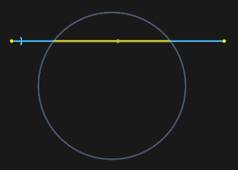
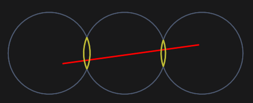

# Trimmen

Die Funktion ermittelt die Schnittpunkte des ausgewählten Elements mit anderen Elementen und hebt den Abschnitt hervor, der nach Bestätigung durch Anklicken entfernt wird.

Nach der Bestätigung:

Sie können auch Abschnitte mehrerer Elemente gleichzeitig trimmen, indem Sie die Maustaste gedrückt halten und ziehen.

Nach dem Loslassen der Maustaste werden die Objektabschnitte entfernt, die von dieser gedachten Linie geschnitten werden:

