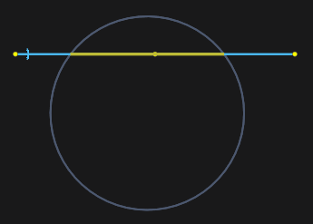
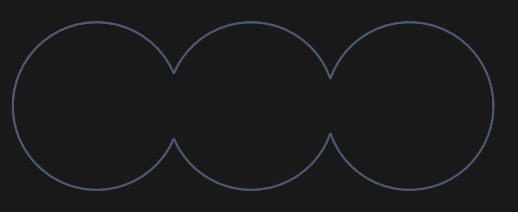

# Trim function

The function finds the intersection points of the specified element with others and highlights the area that will be deleted after confirmation by clicking.

After confirmation:

You can also cut fragments of several elements at once by pressing the mouse button and dragging.

All intersections of objects with this imaginary line will be removed after releasing the mouse button:

**Check line type.** An option in the inspector of the command. It defines which objects act as trimming boundaries:

- **ON** (default) — only objects of the same line type as the trimmed element act as boundaries. For example, a thin or dot-and-dash line does not trim a general line;
- **OFF** — all objects of the plane act as boundaries, whatever their line type.

The option applies to hovering, clicking and dragging, and to splitting an element with **Split complex object into elements**. Its value is not saved in the project.

An element that does not intersect any boundary is deleted as a whole, which is why the command is called **Trim or delete**. A spline, an Archimedean spiral, a function profile and a block insert are always deleted as a whole. A profile or a box is split into separate elements when trimmed; the remaining parts keep their color and line type. **[Del]** in trim mode deletes the highlighted object.
