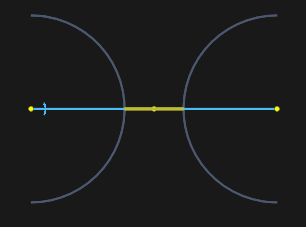

# Objekt zerlegen

Die Funktion zerlegt das ausgewählte zusammengesetzte Element ([Rechteck](20009.md), [Kontur](20013.md), [benannter Block](20029.md)) in seine Bestandteile. Ein Block wird in die Elemente zerlegt, aus denen er erstellt wurde.

Wenn Sie ein einfaches Objekt ([Linie](20001.md), [Bogen](20002.md), [Kreis](20006.md)) auswählen, wird es an den Schnittpunkten mit anderen Elementen in mehrere Elemente aufgeteilt.

