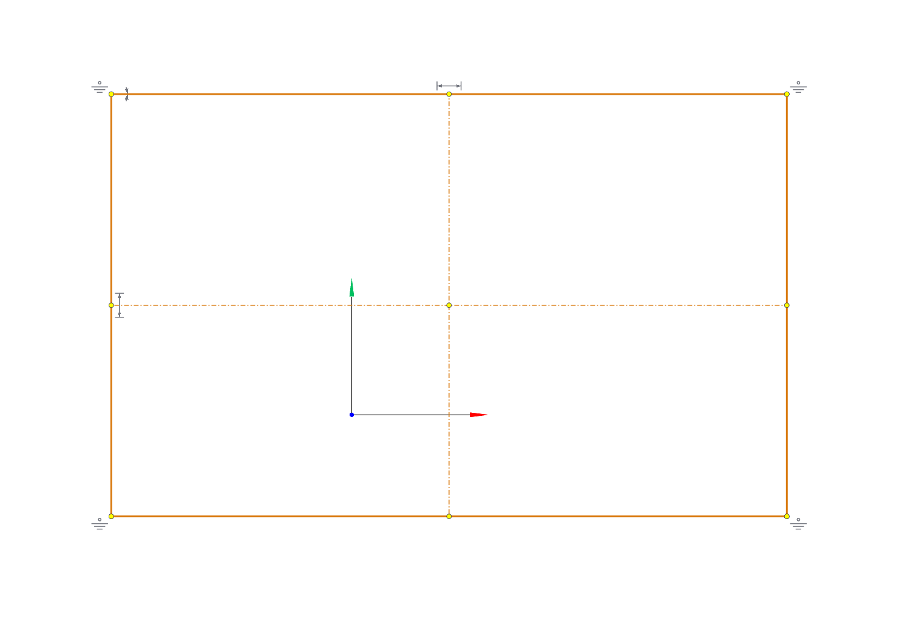
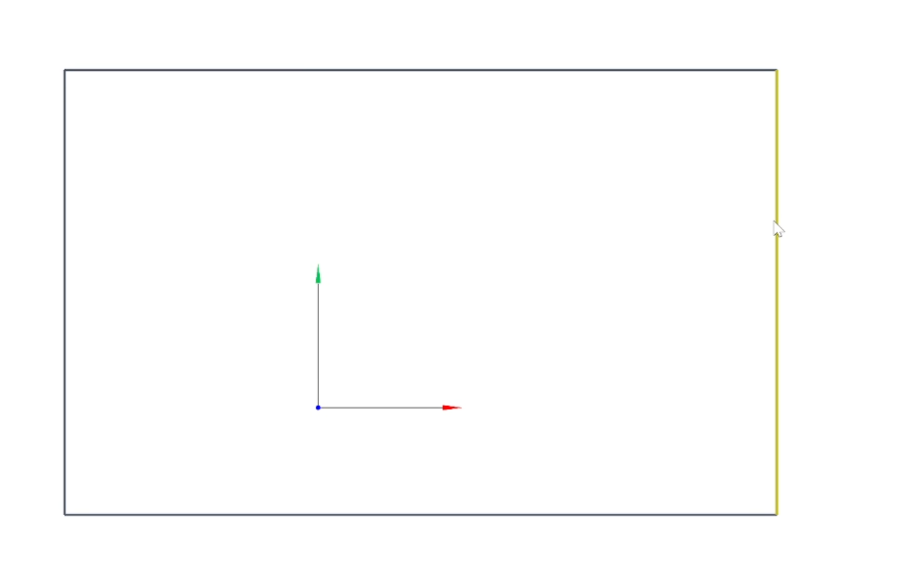
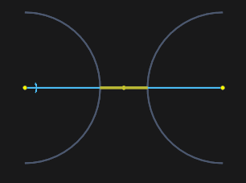

# Split object

The **Split object** button provides two modes.

## Split complex object into elements

- A [box](20009.md) or [profile](20013.md) is split into its constituent elements.
- A spline, an Archimedean spiral or a function profile becomes an ordinary profile.
- Text becomes closed profiles following the outlines of the letters.
- A line, arc or circle is split at the two intersections nearest the click, into no more than three parts. The trim command's **Check line type** option also applies. [Details](20022.md)
- A [block insert](20029.md) is split into objects; nested inserts remain inserts.

## Split object at point

A line or arc is split into two parts at the clicked point. A circle is not split, and clicking an endpoint has no effect. A closed profile becomes open; an open profile is split into two independent profiles.

Splitting a space curve at a point creates two linked spans and hides the original curve. **Range** is expressed as a percentage of its length. [Details](20056.md#span-of-curve)
