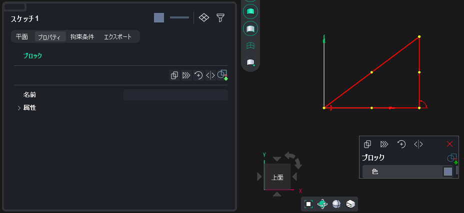

# Additional functions

Additional functions are available when editing single objects and blocks. The commands are [Copy](20025.md), [Move](20026.md), [Rotate](20027.md) and [Symmetry](20028.md).

