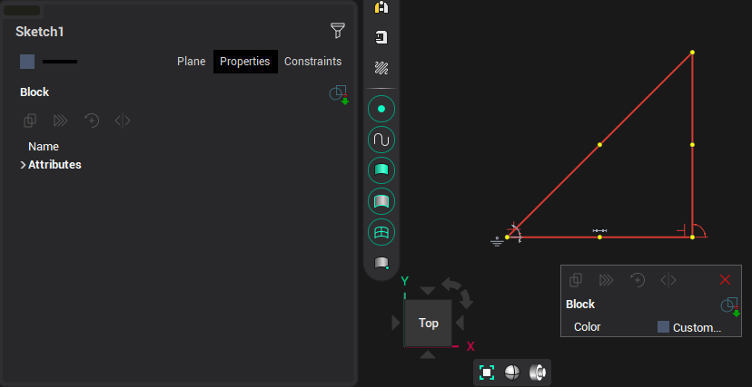

# Zusätzliche Funktionen

Beim Bearbeiten einzelner Objekte und Blöcke stehen zusätzliche Funktionen zur Verfügung. Die zugehörigen Schaltflächen befinden sich im Inspektor und im Kontextmenü, das mit der rechten Maustaste geöffnet wird.

