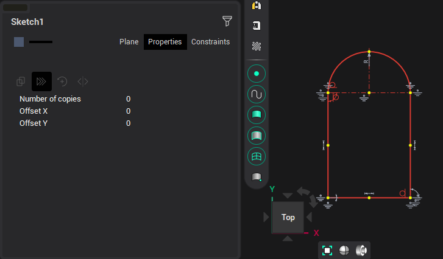

# Traslazione

Trasla un gruppo di oggetti di una distanza specificata. È inoltre possibile specificare il numero di copie: ogni copia successiva verrà traslata del valore specificato rispetto alla precedente.

