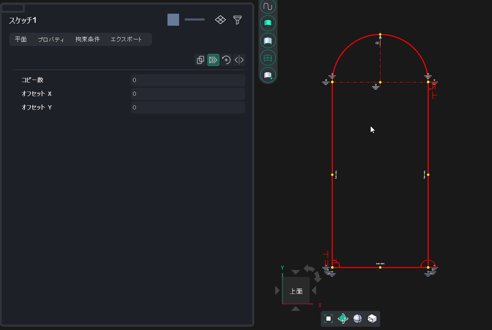

# Move

Shift a group of objects by a specified distance. In addition, you can specify the number of copies and each next copy will be shifted by the specified value from the previous one.

**Move.** The translation vector (X | Y). The base point can be dragged with the mouse.

**Number of copies.** Each subsequent copy is shifted by the same vector from the previous copy.
