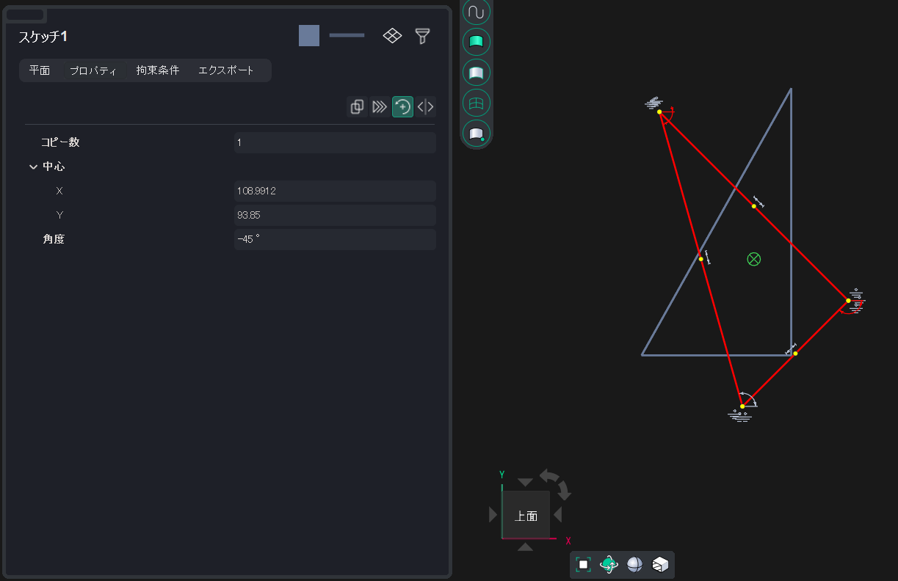

# Girar

O objeto é girado em torno do ponto especificado pelo ângulo especificado. A rotação pode ser feita de forma interativa ou especificando as coordenadas e o ângulo no inspetor. Além disso, você pode especificar o número de cópias, e cada cópia seguinte será girada pelo valor especificado em relação à anterior.

