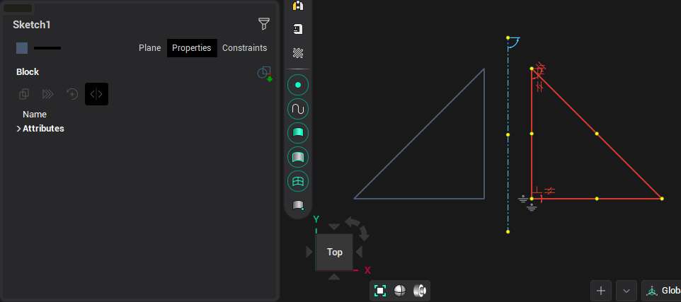

# Symmetry

For mirror, you must specify the axis relative to which the mirror will be performed.

**Symmetry.** Select a line as the axis. The object is mirrored in place; no copy is created. To keep the original, use **Copy** first.
