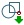
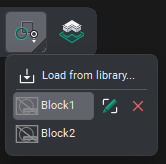
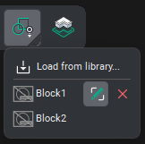

# Named block

To create a named block, you need to select the necessary elements in the block. To do this, by pressing the mouse button and holding it down, select the elements with a rectangular frame, or sequentially select the elements with the **[Shift]** key pressed. The exclusion of elements from the block is also performed by specifying these elements with the **[Shift]** key pressed.

Click **Save block**  in the inspector. This immediately creates a block and opens the **New block** editor. Set **Name** and **Insertion point**, then click **Save block** or press **[Enter]** to save, or click **Cancel**. No rotation angle is set during block creation.

In the future, you can insert this block into the sketch by hovering over the corresponding button and selecting the desired block from the drop-down menu. It is also possible to load a block from the library.

Hovering over a block row shows edit and delete icons on the right. An update-from-library icon appears only when the library contains a newer version. Editing the source block updates all its inserts.

**Angle.** Rotation of a block insert.

**Scale.** Insert scale along X | Y; a negative value mirrors it along the corresponding axis.

Deleting an inserted block requires confirmation and reports the number of inserts: they will be split into individual objects. A block inserted into another block or currently being edited has no delete icon.

Library files are described separately. [Details](20060.md)
