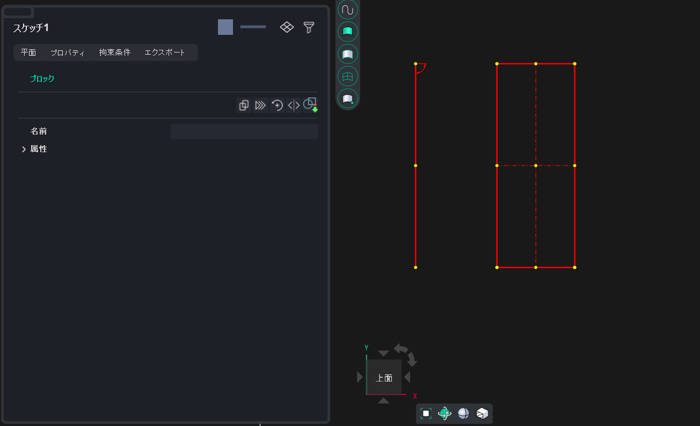
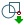
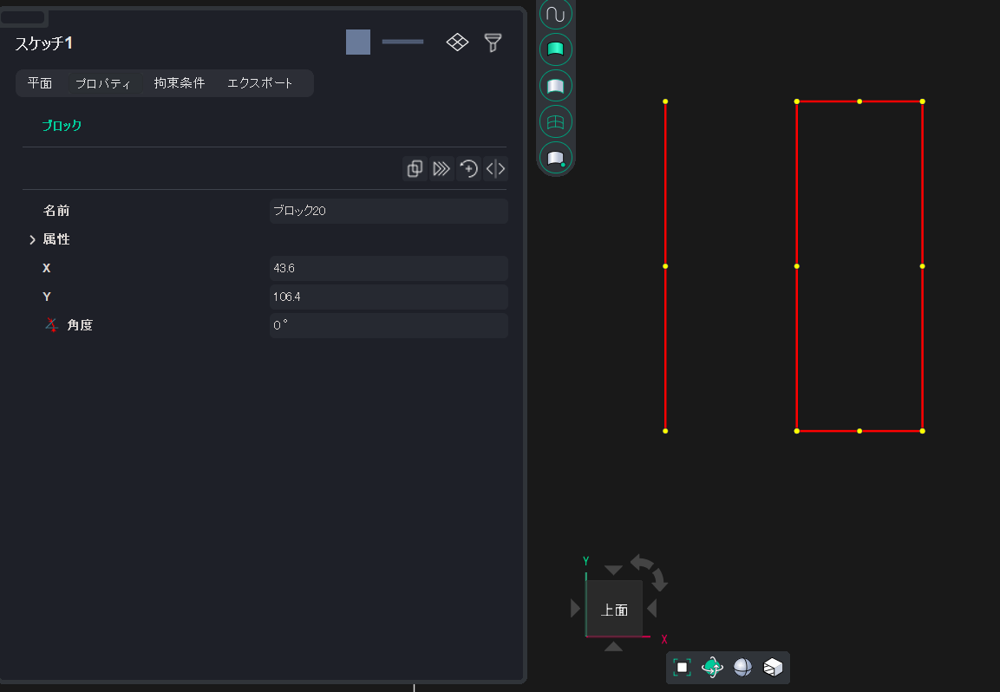
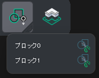

# Bloco nomeado

Para criar um bloco nomeado, selecione os elementos que devem fazer parte do bloco. Para isso, mantendo pressionado o botão do mouse, selecione os elementos com uma moldura retangular ou selecione os elementos sequencialmente com a tecla <strong>[Shift]</strong> pressionada. Para excluir elementos do bloco, indique esses elementos também com a tecla <strong>[Shift]</strong> pressionada.

Clique no botão  no inspetor. Se necessário, é possível digitar o nome do bloco ou definir seu ângulo de rotação.

Depois, é possível inserir esse bloco no desenho passando o mouse sobre o botão correspondente e selecionando o bloco desejado no menu suspenso.

Posteriormente, você pode editar o bloco original clicando na "tesoura" no menu. Todas as cópias do bloco editado também serão alteradas.

