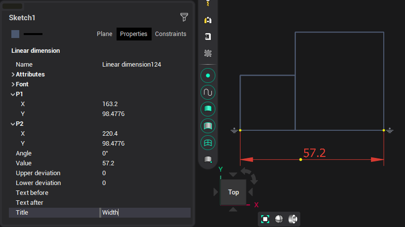
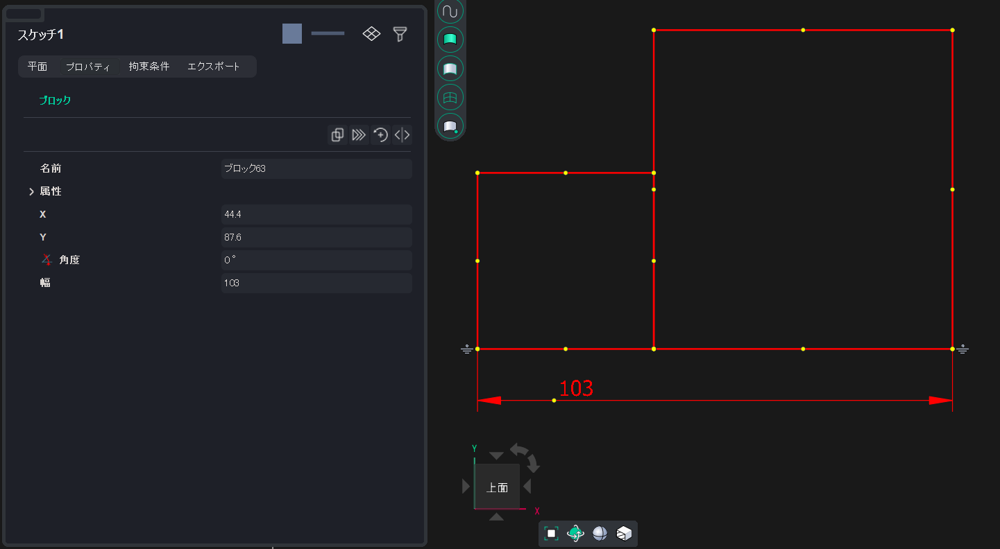

# Parametrização de blocos

Antes de combinar os elementos em um bloco, insira os valores necessários nos campos <strong>[Title]</strong> das cotas.

Depois de mesclar os elementos, esses parâmetros aparecerão no inspetor e estarão disponíveis para edição.

