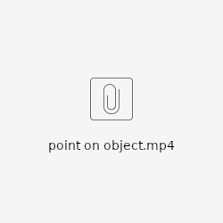
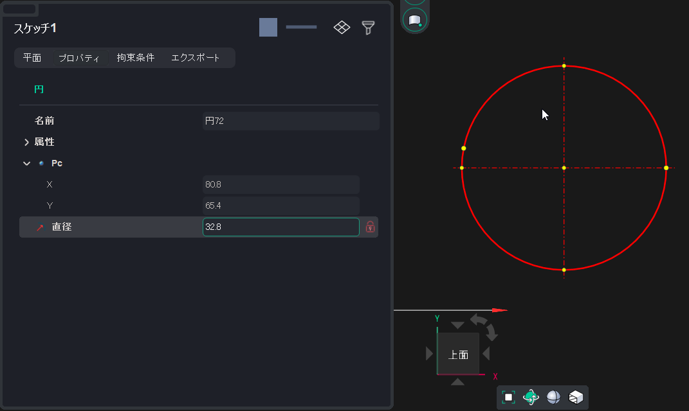
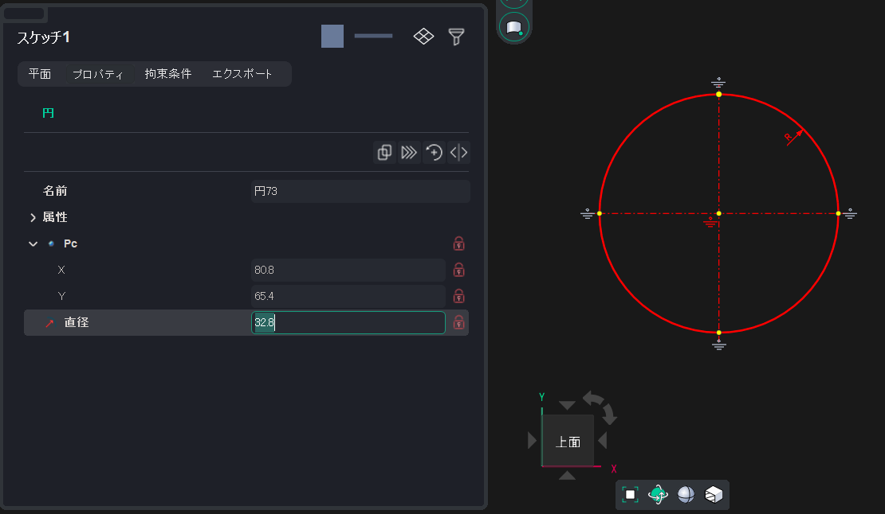
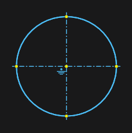

# Zwangsbedingungen

Zwangsbedingungen entstehen während der Konstruktion. Beim Bearbeiten werden sie entfernt, wenn die zugrunde liegenden geometrischen Beziehungen nicht mehr bestehen, beispielsweise wenn Linien nicht mehr parallel sind oder sich Objekte nicht mehr tangential berühren.

Beim Bearbeiten eines Blocks bleiben die Zwangsbedingungen erhalten; die Objekte ändern sich entsprechend diesen Bedingungen. Tangentialität, Parallelität von Linien und andere Beziehungen bleiben somit bestehen.

Arten von Zwangsbedingungen:

- Tangentialität

Halten Sie beim Konstruieren **Strg** (**Ctrl**) gedrückt und wählen Sie das Objekt aus, für das die Bedingung gelten soll. Beispiele sind ein Kreis, der eine Linie tangential berührt, oder ein Liniensegment, das einen Kreis oder Bogen tangential berührt.

Bei der Konstruktion einer Linie wird zusätzlich zur Tangentialität festgelegt, dass der Punkt auf dem Kreis liegt.

- Punkt auf einem Kreis, einer Linie oder einem Bogen

Liegt ein Punkt beim Konstruieren auf einem Objekt, wird die entsprechende Beziehung hergestellt. Fällt der Punkt mit einem Punkt eines anderen Objekts zusammen, werden zwei gemeinsame Beziehungen erstellt. Beim Bearbeiten des Blocks wird dieser Punkt dann gemeinsam verwendet.

- Parallelität und Rechtwinkligkeit

Wenn Sie während der Konstruktion bei gedrückter **Strg**-Taste den Mauszeiger auf eine Linie bewegen, erscheinen Hilfslinien und eine entsprechende Beziehung wird hergestellt. Sie können diese Beziehung auch im Inspektor auf der Registerkarte **Links** festlegen. Erfüllen die Linien die Bedingung noch nicht, werden sie entsprechend angepasst.

- Ausrichtung

Die Linien liegen auf derselben Geraden. Diese Beziehung kann durch Trimmen entstehen. Sie kann auch im Inspektor auf der Registerkarte **Links** festgelegt werden.

- Fixierung

Die X- und Y-Koordinaten von Punkten können einzeln oder gemeinsam fixiert werden. Ebenso lassen sich Länge, Radius, Winkel sowie Höhe und Breite eines Rechtecks fixieren. Verwenden Sie dazu die Schaltflächen im Inspektor:

Alternativ verwenden Sie die Fixierungssymbole in der Zeichnung:

Bei Bemaßungen können Sie im Inspektor **Value** (Maßwert), **Radius** oder **Angle** (Winkel) fixieren. Beim Bearbeiten im Blockmodus bleibt das betreffende Maß dann unverändert.

- Achsen

Wenn Sie beim Konstruieren einer Linie auf einen Bogen oder Kreis doppelklicken, werden Achslinien erstellt, die sich bei Änderungen dieses Elements entsprechend anpassen.

- Gleichheit

Die Gleichheit von Streckenlängen sowie Bogen- und Kreisradien wird beim Kopieren mit Vervielfältigung festgelegt. Sie können diese Beziehung auch im Inspektor auf der Registerkarte **Links** erstellen.

- Lineare Bemaßung

Eine Verknüpfung zur linearen Bemaßung wird erstellt, wenn die Bemaßung einer Linie zugeordnet wird. Bei der späteren Bearbeitung des Liniensegments wird auch die Bemaßung angepasst.

- Zusammenfallende Punkte

Diese Beziehung entsteht während der Konstruktion, wenn Punkte verschiedener Objekte zusammenfallen. Sie kann auch im Inspektor auf der Registerkarte **Links** festgelegt werden.

- Objektbildende Beziehungen

Diese Beziehungen verbinden die Bestandteile komplexer Objekte, beispielsweise einer Kontur, radialen Bemaßung, Winkelbemaßung, eines Rechtecks, einer Verrundung, Fase oder Beschriftung. Die Beziehung bleibt bestehen, solange das ursprüngliche Objekt existiert.
