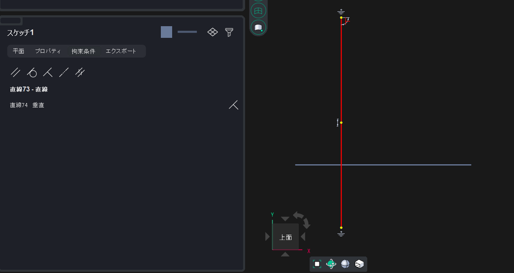
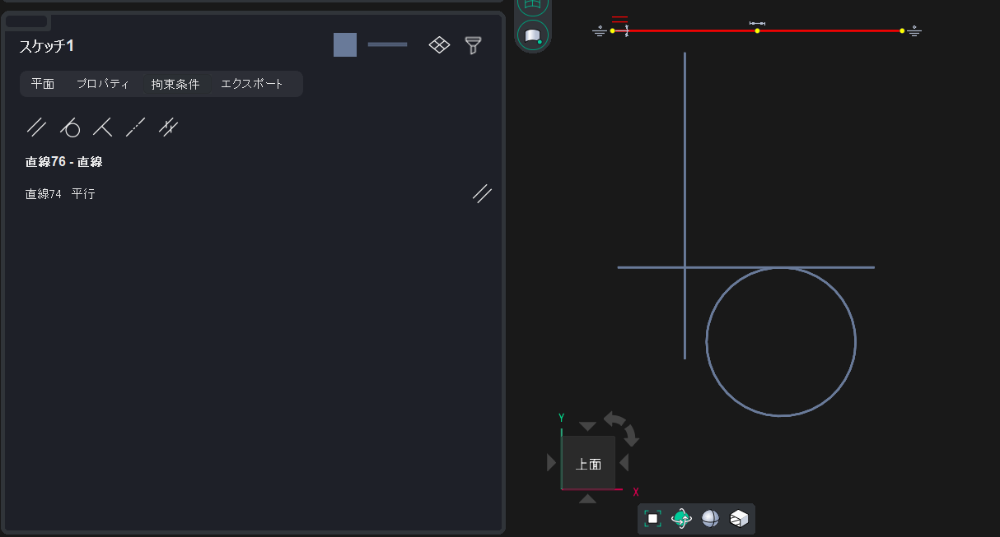

# Editing links in a block

In the inspector, in the **Constraints** tab, a list of the active element's links is shown.

Clicking a constraint icon in the inspector removes the constraint; hovering over it highlights it.

To create links **Parallel**, **Tangential**, **Perpendicular**, **Equal** in block mode, press the corresponding button and sequentially select a pair of objects.

A constraint that conflicts with locks is not created. Clicking a constraint symbol on the sketch removes constraints of that type from the object. [Details](20031.md)
