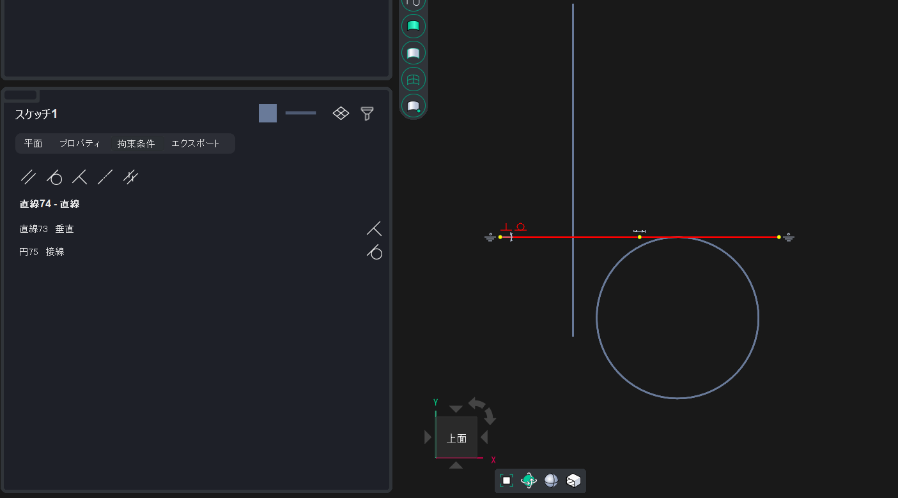

# ブロック内のリンクを編集

インスペクターの <strong>`拘束条件`</strong> タブに、アクティブな要素のリンクのリストが表示されます。

ブロックモードでは、リンク画像をクリックすることで制限を無効/有効に切り替えることができます。

ブロックモードで <strong>`平行`、</strong> <strong>`接線`、</strong> <strong>`直角`、</strong> <strong>`同軸`、</strong> <strong>`等価`</strong> のリンクを作成するには、対応するボタンを押して、オブジェクトのペアを順次選択します。

ボタンを離すと、リンク有効／無効モードに戻ります。ブロックモードを終了すると、切断されたリンクは完全に無効になります。
