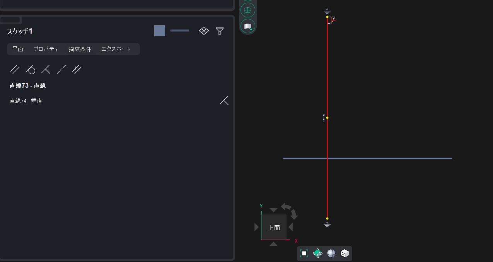
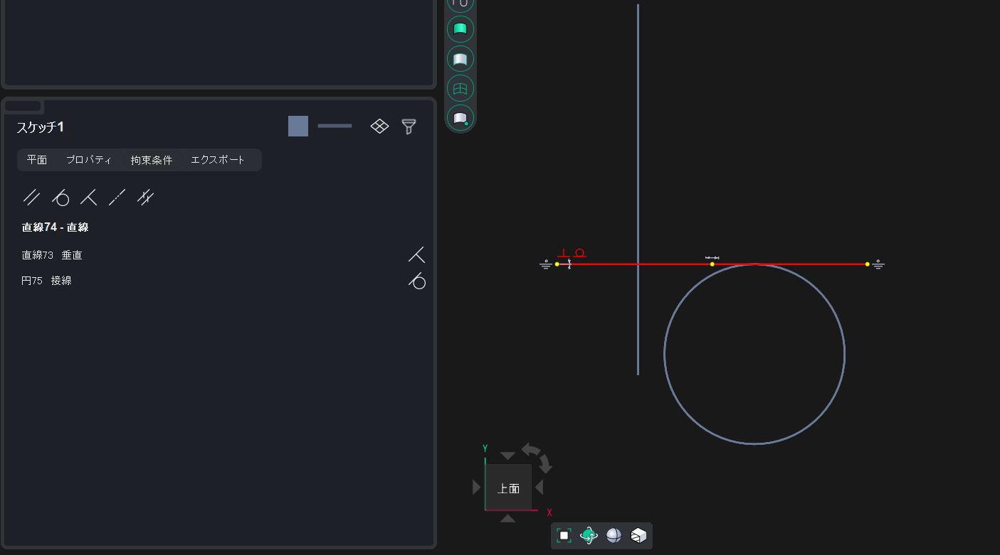
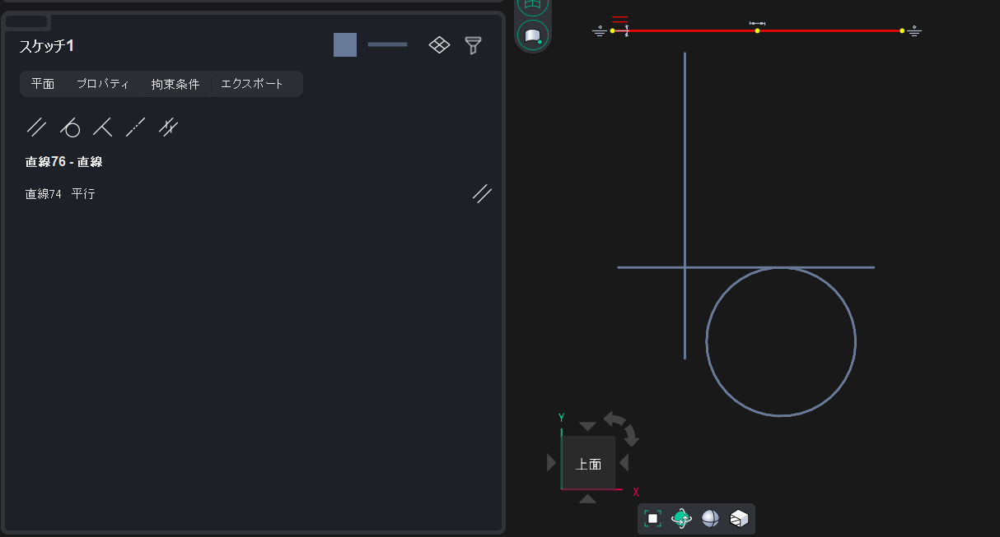

# Edição de vínculos em um bloco

No inspetor, na guia <strong>Constraints</strong>, é exibida a lista de vínculos do elemento ativo.

No modo de bloco, é possível desativar/ativar a restrição clicando na imagem do vínculo.

Para criar os vínculos <strong>Parallelism,</strong> <strong>Tangency,</strong> <strong>Perpendicularity,</strong> <strong>Coaxiality,</strong> <strong>Equality</strong> (paralelismo, tangência, perpendicularidade, coaxialidade, igualdade) no modo de bloco, pressione o botão correspondente e selecione sequencialmente um par de objetos.

Ao liberar o botão, volta-se ao modo de ativação/desativação de vínculos. Após sair do modo de bloco, os vínculos desativados são desativados permanentemente.
