# Esempio di costruzione di un disegno mediante vincoli

Come esempio, si prenda lo stesso disegno precedente:

Per iniziare, dal punto 0,0 si costruiscono tre cerchi di raggio arbitrario, rispettando però più o meno la scala. Dal centro si traccia una retta con un angolo arbitrario per il cerchio R4. Non si rispettano le quote: verranno poi portate ai valori indicati nel disegno. Si costruisce un cerchio e lo si ruota con copia di un angolo di 41°, avendo indicato in precedenza il centro di rotazione nel punto 0.0. Quindi si costruiscono gli assi per i cerchi ottenuti e si inseriscono le quote angolari e radiali:

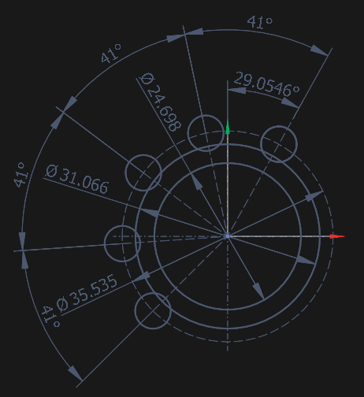

Si eliminano le parti in eccesso con il taglio:

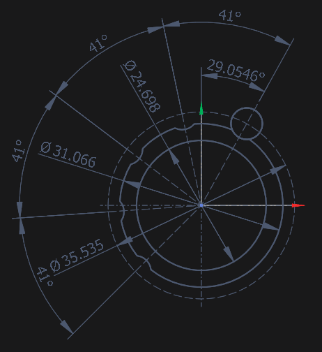

Ora si seleziona l'intero disegno con la combinazione di tasti <strong>[Ctrl-A]</strong> e si modifica il raggio del cerchio a 4, quindi si modifica l'angolo a 30. Dopodiché si bloccano gli angoli dei segmenti e le quote angolari di 41°, quindi si selezionano di nuovo tutti gli elementi nel blocco e si impostano i valori dei diametri secondo il disegno:

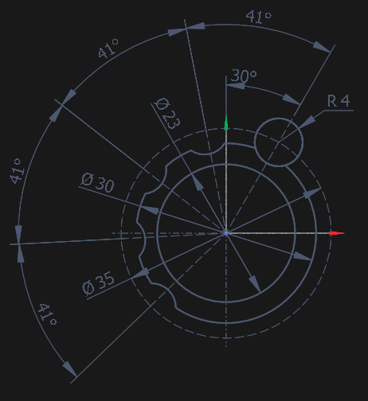

Si bloccano i raggi dei cerchi costruiti in precedenza e degli archi ottenuti. Poi si prolunga a destra l'asse del cerchio con un margine per le costruzioni successive. Si costruisce un cerchio con il centro sulla retta così ottenuta, con un margine, quindi si elimina l'eccesso e lo si quota:

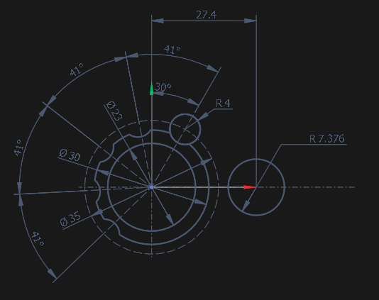

Si blocca il centro dell'arco Ø30, si seleziona in un blocco un gruppo di elementi e si attiva un nuovo cerchio nel blocco. Quindi, nell'ispettore, nella scheda <strong>Constraints</strong> (vincoli), si aggiunge il vincolo <strong>Tangential to the circle</strong> (tangente al cerchio) e si specifica la parte del cerchio Ø30, si imposta il raggio secondo il disegno e lo si blocca:

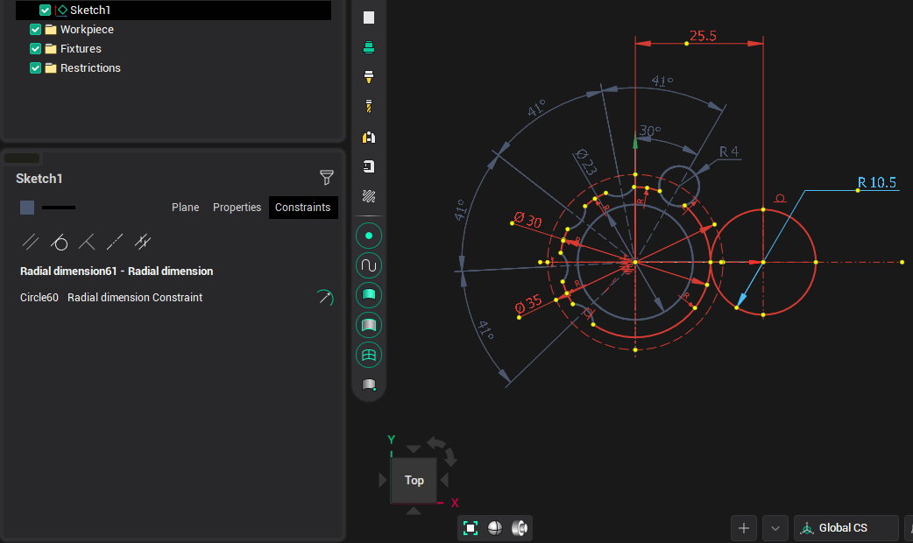

Nel cerchio ottenuto è possibile bloccare il centro. Poi, sull'asse, si costruisce un piccolo cerchio di diametro 3.5 e si inserisce una quota lineare dal punto zero al suo centro. Nel blocco si impostano le quote secondo il disegno e si blocca il centro. Si costruisce un asse verticale per un cerchio di 3.5 e, equidistante da questo asse a una distanza di 1.5, si costruisce un punto all'interno di un arco di diametro 5.7 e se ne blocca l'angolo:

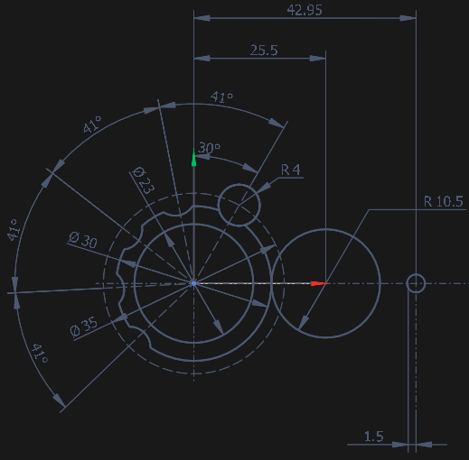

Ora si costruisce una linea ausiliaria per la quota 50.1 dal punto zero, si regola la quota e si costruisce un cerchio ausiliario di raggio 3.5:

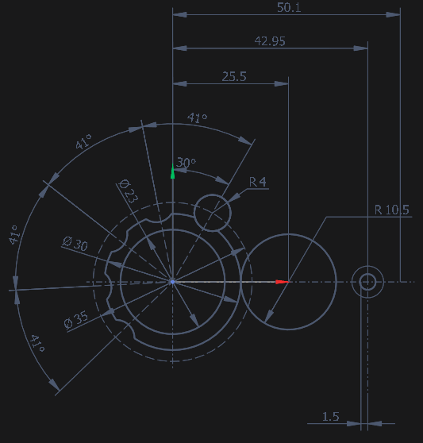

Si costruisce una quota verticale e la si imposta a 7.2 nel blocco, dopo aver bloccato il punto superiore. Si costruisce una retta tangente al cerchio ausiliario di raggio 3.5, che intersechi la linea ausiliaria appena sopra l'asse. Si elimina la linea ausiliaria e si costruisce un cerchio con il centro nel punto ottenuto e passante per il punto di intersezione della tangente e della verticale a 65.4. Si quota il cerchio ottenuto:

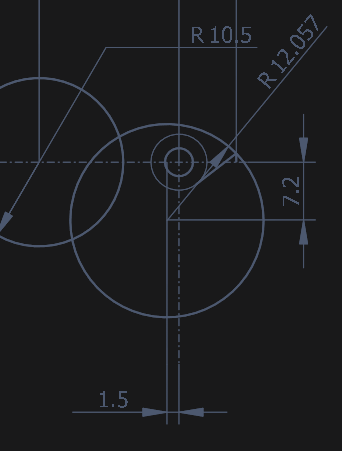

Nel blocco si imposta il raggio a 11.71, quindi si costruisce un arco di raggio 7 tangente ai cerchi R10.5 e R11.71 e si elimina l'eccesso.

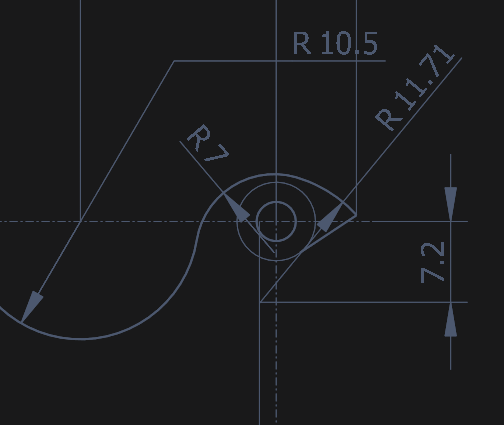

Per costruire gli archi R5.7 e R0.4, si prolunga la retta inclinata e si costruisce una retta equidistante da essa a una distanza di 5.7, e da questa un'altra a una distanza di 0.8; si collegano le prime due con una retta e tra di esse si inserisce un arco. Si costruisce una retta temporanea passante per il centro di un piccolo cerchio e parallela alla terza retta, e da essa una equidistante, inserendo anche qui un piccolo arco. Si quotano gli elementi ottenuti, si eliminano e si tagliano le parti in eccesso.

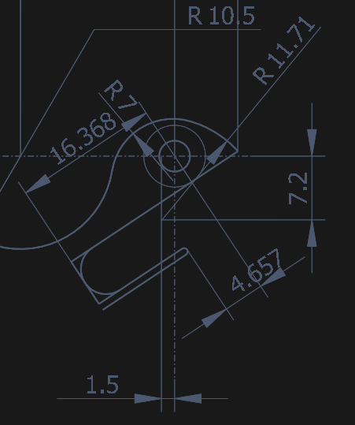

Si bloccano gli angoli delle rette, e i punti delle quote che giacciono al centro del cerchio e nel blocco vengono modificati con i valori del disegno.

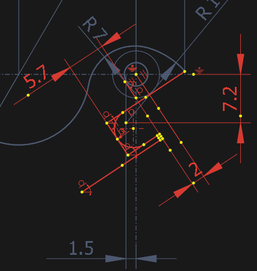

Si eliminano le parti in eccesso oppure si cambia il tipo di linea.

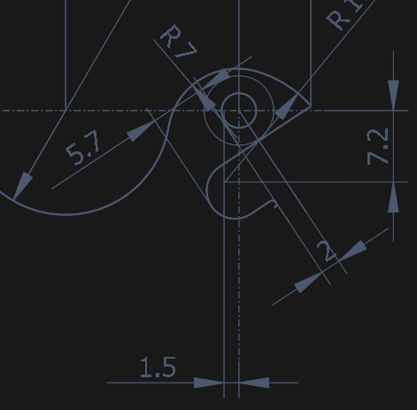

Si raccordano l'arco R0.4 e il cerchio sinistro con l'arco R30 mediante l'arco R50. Si elimina l'eccesso dall'arco R0.4

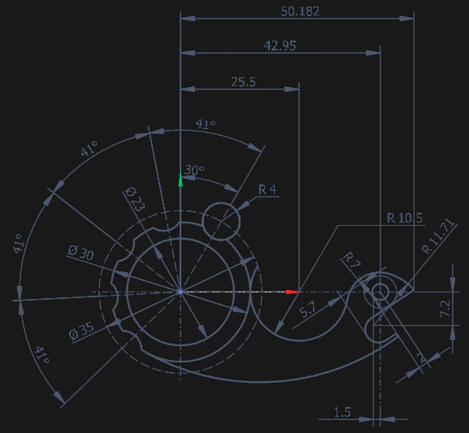

Ora si costruiscono 3 archi paralleli a R50, R10.5 e R30, si bloccano i centri e li si fa coincidere con gli archi, si impostano le quote e si elimina l'eccesso.

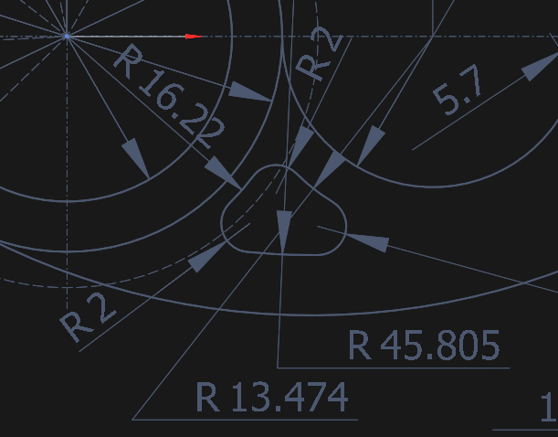

Nel blocco si impostano le quote secondo il disegno. Per prima cosa si impostano i raggi degli archi grandi e si blocca il raggio dopo ogni regolazione. Poi si imposta il raggio di raccordo:

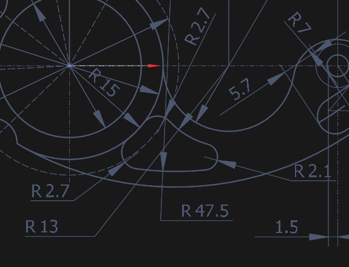

In questo modo si ottiene il disegno richiesto.

