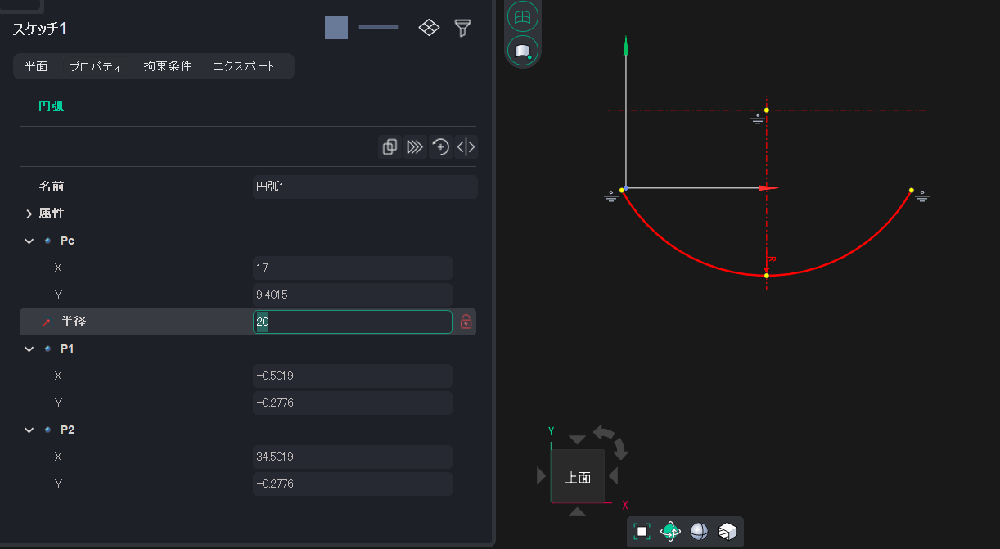

# Bogen bearbeiten

Ausgewählte Bögen können durch Verschieben ihrer Punkte im Grafikfenster oder durch Ändern der Parameter im Inspektor bearbeitet werden.

Beim Bearbeiten eines Bogens können Sie alle Parameter durch Anklicken des Schlosssymbols im Inspektor oder des entsprechenden Symbols am Bogen fixieren. Zum Hinzufügen von Achslinien aktivieren Sie **Line** (Linie) und doppelklicken auf den Bogen.

Beim Bearbeiten eines Bogens können Sie Hilfslinien verwenden. Standardmäßig werden vom ersten oder zweiten Punkt aus Hilfslinien bei 0°, 45° und 90° sowie in Bezug auf den Kreismittelpunkt und die Mitte des Bogens angeboten.

Weitere Hilfslinien können Sie erzeugen, indem Sie den Mauszeiger über einen Punkt eines vorhandenen Objekts bewegen.
